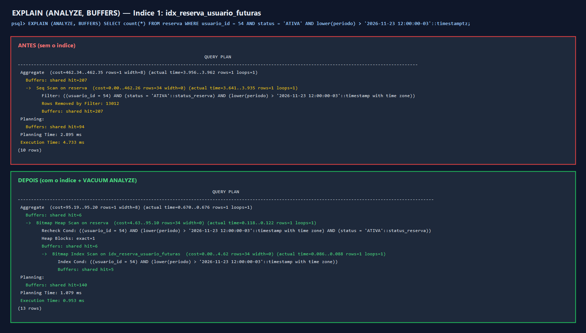
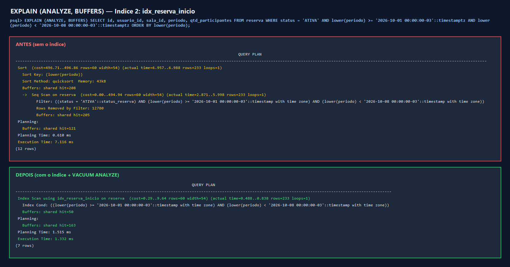

# Análise de Desempenho: Índices e `EXPLAIN (ANALYZE, BUFFERS)`

## 1. Contextualização e por que o `EXCLUDE` não cobria essas consultas

A tabela `reserva` (`13.013` registros, `1616 kB`) já possui dois índices criados automaticamente na Fase 2:
- `reserva_pkey` (`btree (id)`, `304 kB`)
- `sem_conflito` (`gist (sala_id, periodo) WHERE status = 'ATIVA'`, `1080 kB`)

O índice GiST `sem_conflito` tem `sala_id` como coluna líder e indexa `periodo` para operadores de intervalo (`&&`, `@>`). Portanto, **ele não ajuda** em duas consultas essenciais do sistema:
1. A contagem de reservas futuras por usuário executada dentro do trigger `fn_regras_reserva` (regra `RS008`) a cada `INSERT`/`UPDATE`, que filtra por `usuario_id`, `status = 'ATIVA'` e `lower(periodo) > now()` (sem `sala_id`).
2. Consultas globais por janela temporal (todas as salas, sem `sala_id`) ordenadas por horário de início `lower(periodo)`, como painéis semanais e relatórios gerenciais.

**Decisão sobre massa de teste:** não foi necessário criar o banco separado `reservas_bench`, pois sobre as `13.013` linhas da Fase 6 as duas consultas já apresentam seletividade alta (`1` linha retornada na Consulta 1; `233` linhas na Consulta 2, ~`1,8%` da tabela), levando o otimizador a trocar imediatamente `Seq Scan` pelos novos índices B-tree após `ANALYZE`. Cada medição foi executada `3×` consecutivas com cache aquecido, registrando a 3ª execução.

---

## 2. Experimento 1 — `idx_reserva_usuario_futuras`

```sql
CREATE INDEX idx_reserva_usuario_futuras
  ON reserva (usuario_id, (lower(periodo)))
  WHERE status = 'ATIVA';
```

**Consulta-alvo 1 (checada no trigger `fn_regras_reserva` e base de `v_reservas_usuario`):**

```sql
EXPLAIN (ANALYZE, BUFFERS)
SELECT count(*)
  FROM reserva
 WHERE usuario_id = 54
   AND status = 'ATIVA'
   AND lower(periodo) > '2026-11-23 12:00:00-03'::timestamptz;
```

### Comparativo Antes × Depois

| Métrica | Antes (`antes_1.txt`) | Depois (`depois_1.txt`) | Variação |
|---|---|---|---|
| **Nó de acesso** | `Seq Scan on reserva` | `Bitmap Heap Scan` ← `Bitmap Index Scan` (`idx_reserva_usuario_futuras`) | Troca para índice parcial |
| **Custo estimado** | `0.00..462.35` | `4.63..95.20` | **-79,4%** |
| **Planning Time** | `2.895 ms` | `1.079 ms` | **-62,7%** |
| **Execution Time** | **`4.733 ms`** | **`0.953 ms`** | **~5,0× mais rápido (-79,9%)** |
| **Buffers (`shared hit`)** | `207` páginas | `6` páginas (`5` índice + `1` heap) | **-97,1% de I/O lógico** |
| **`Rows Removed by Filter`** | **`13.012` linhas descartadas** | **`0` linhas descartadas** | Eliminação total de descarte |
| **Linhas estimadas × reais** | `rows=34` est. / `1` real | `rows=34` est. / `1` real | Estimativa igual nos dois planos |



**Leitura técnica:** Sem o índice, o PostgreSQL lia todas as `207` páginas da tabela `reserva` para descartar `13.012` linhas e contar `1` registro. Com `idx_reserva_usuario_futuras`, o `Bitmap Index Scan` localiza diretamente a entrada daquele usuário e período ativo em `5` páginas de índice e visita apenas `1` bloco exato do heap (`Heap Blocks: exact=1`), reduzindo o tempo de execução de `4.733 ms` para `0.953 ms`.

---

## 3. Experimento 2 — `idx_reserva_inicio`

```sql
CREATE INDEX idx_reserva_inicio
  ON reserva ((lower(periodo)))
  WHERE status = 'ATIVA';
```

**Consulta-alvo 2 (agenda semanal global sem filtro por sala, ordenada por início):**

```sql
EXPLAIN (ANALYZE, BUFFERS)
SELECT id, usuario_id, sala_id, periodo, qtd_participantes
  FROM reserva
 WHERE status = 'ATIVA'
   AND lower(periodo) >= '2026-10-01 00:00:00-03'::timestamptz
   AND lower(periodo) <  '2026-10-08 00:00:00-03'::timestamptz
 ORDER BY lower(periodo);
```

### Comparativo Antes × Depois

| Métrica | Antes (`antes_2.txt`) | Depois (`depois_2.txt`) | Variação |
|---|---|---|---|
| **Plano de execução** | `Sort (quicksort, 43kB)` ← `Seq Scan on reserva` | **`Index Scan using idx_reserva_inicio`** | Eliminou `Seq Scan` **e** `Sort` |
| **Custo estimado** | `0.00..496.86` | `0.29..9.64` | **-98,1%** |
| **Planning Time** | `0.610 ms` | `1.515 ms` | +0.905 ms (avaliação do índice) |
| **Execution Time** | **`7.116 ms`** | **`1.332 ms`** | **~5,3× mais rápido (-81,3%)** |
| **Buffers (`shared hit`)** | `208` páginas | `50` páginas | **-76,0% de I/O lógico** |
| **`Rows Removed by Filter`** | **`12.780` linhas descartadas** | **`0` linhas descartadas** | Eliminação total de descarte |
| **Linhas estimadas × reais** | `rows=60` est. / `233` reais | `rows=60` est. / `233` reais | Mesmo recorte; ordenação já vem pronta |



**Leitura técnica:** Além de substituir o `Seq Scan` (que lia `205` páginas e descartava `12.780` linhas) pelo `Index Scan`, a estrutura ordenada da árvore B-tree em `lower(periodo)` entregou as `233` tuplas já na ordem solicitada por `ORDER BY lower(periodo)`, **eliminando completamente o nó `Sort` (quicksort em memória)**.

---

## 4. Custo em Disco, Impacto de Escrita e Limites de Uso

### Espaço em disco (`pg_relation_size`)

| Objeto | Tipo / Definição | Tamanho |
|---|---|---|
| `reserva` (tabela) | Heap (`13.013` linhas) | `1616 kB` |
| `sem_conflito` | GiST parcial (`sala_id, periodo WHERE ATIVA`) | `1080 kB` |
| `idx_reserva_usuario_futuras` | B-tree parcial (`usuario_id, lower(periodo) WHERE ATIVA`) | **`384 kB`** |
| `reserva_pkey` | B-tree (`id`) | `304 kB` |
| `idx_reserva_inicio` | B-tree parcial (`lower(periodo) WHERE ATIVA`) | **`160 kB`** |

Os dois novos índices somam juntos `544 kB` (~`33,7%` do tamanho da tabela heap), mantidos enxutos pelo filtro parcial `WHERE status = 'ATIVA'`, que exclui ~`8%` das linhas (`CANCELADA`).

### Impacto nas operações de escrita (`INSERT` / `UPDATE`)
- Todo índice adiciona custo de manutenção em escrita: um `INSERT` de reserva ativa atualiza `reserva_pkey`, `sem_conflito`, `idx_reserva_usuario_futuras` e `idx_reserva_inicio`. Um `UPDATE` que cancela a reserva (`ATIVA → CANCELADA`) também remove a entrada dos 3 índices parciais.
- **Compensação líquida no projeto:** em todo `INSERT` válido, o trigger `fn_regras_reserva` executa a consulta do Experimento 1 (limite de 3 futuras). Sem `idx_reserva_usuario_futuras`, cada inserção leria ~`207` páginas via `Seq Scan`; com o índice, lê `~6` páginas — logo, o Índice 1 **reduz** o custo total de cada `INSERT` feito por `criar_reserva()`.

### Quando o planner **não** usaria os índices
1. **Baixa seletividade (intervalo amplo):** se a consulta pedir reservas de 6 ou 12 meses inteiros (> ~15–20% da tabela), ler o índice + buscar páginas aleatórias no heap custaria mais do que um único `Seq Scan` sequencial, e o planner escolherá `Seq Scan`.
2. **Expressão ou predicado incompatível:** se a query filtrar por `periodo && ...` sem extrair `lower(periodo)` ou omitir `status = 'ATIVA'`, o planner não consegue provar que os índices parciais/funcionais cobrem a consulta.
3. **Tabela muito pequena ou estatísticas desatualizadas:** sem `ANALYZE`, o planner pode subestimar/superestimar linhas e escolher o plano errado.
