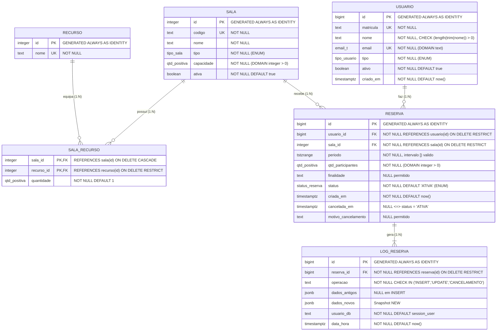

# DER Lógico — Sistema de Reserva de Salas e Laboratórios

Este diagrama lógico corresponde **1:1** ao esquema implementado em [`sql/01_tipos.sql`](../sql/01_tipos.sql) e [`sql/02_tabelas.sql`](../sql/02_tabelas.sql) no schema `reservas`.

---

## Tipos Customizados (`01_tipos.sql`)

| Tipo | Categoria | Definição / Valores | Uso nas tabelas |
|---|---|---|---|
| `status_reserva` | `ENUM` | `'ATIVA'`, `'CANCELADA'` | `reserva.status` |
| `tipo_usuario` | `ENUM` | `'ALUNO'`, `'PROFESSOR'`, `'ADMIN'` | `usuario.tipo` |
| `tipo_sala` | `ENUM` | `'SALA'`, `'LABORATORIO'` | `sala.tipo` |
| `email_t` | `DOMAIN` (`text`) | `CHECK (VALUE ~* '^[^@\s]+@[^@\s]+\.[^@\s]+$')` | `usuario.email` |
| `qtd_positiva` | `DOMAIN` (`integer`) | `CHECK (VALUE > 0)` | `sala.capacidade`, `sala_recurso.quantidade`, `reserva.qtd_participantes` |

---

## Constraints Declarativas por Tabela (`02_tabelas.sql`)

| Tabela | Tipo | Nome / Expressão | Regra garantida |
|---|---|---|---|
| `usuario` | `PK` | `id` | Identidade substituta imutável |
| `usuario` | `UNIQUE` | `matricula`, `email` | Chaves candidatas únicas |
| `usuario` | `CHECK` | `length(trim(nome)) > 0` | Impede nome vazio ou só com espaços |
| `sala` | `PK` / `UNIQUE` | `id` / `codigo` | Identidade substituta e código único |
| `recurso` | `PK` / `UNIQUE` | `id` / `nome` | Identidade substituta e nome único |
| `sala_recurso` | `PK` / `FK` | `(sala_id, recurso_id)` | Relação N:N sem duplicata de recurso na mesma sala |
| `reserva` | `PK` / `FK` | `id` / `usuario_id`, `sala_id` | Integridade referencial com `ON DELETE RESTRICT` |
| `reserva` | `CHECK` | `ck_periodo_valido` | `NOT isempty(periodo) AND NOT lower_inf(periodo) AND NOT upper_inf(periodo) AND lower_inc(periodo) AND NOT upper_inc(periodo)` |
| `reserva` | `CHECK` | `ck_cancelamento_coerente` | `(status = 'CANCELADA') = (cancelada_em IS NOT NULL)` |
| `reserva` | `EXCLUDE` | `sem_conflito` | `EXCLUDE USING gist (sala_id WITH =, periodo WITH &&) WHERE (status = 'ATIVA')` — bloqueia sobreposição na mesma sala via `btree_gist` |
| `log_reserva` | `PK` / `FK` | `id` / `reserva_id` | Trilha append-only (`ON DELETE RESTRICT`) |
| `log_reserva` | `CHECK` | `operacao` | `operacao IN ('INSERT', 'UPDATE', 'CANCELAMENTO')` |
