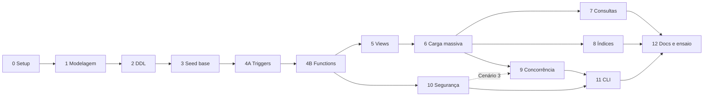
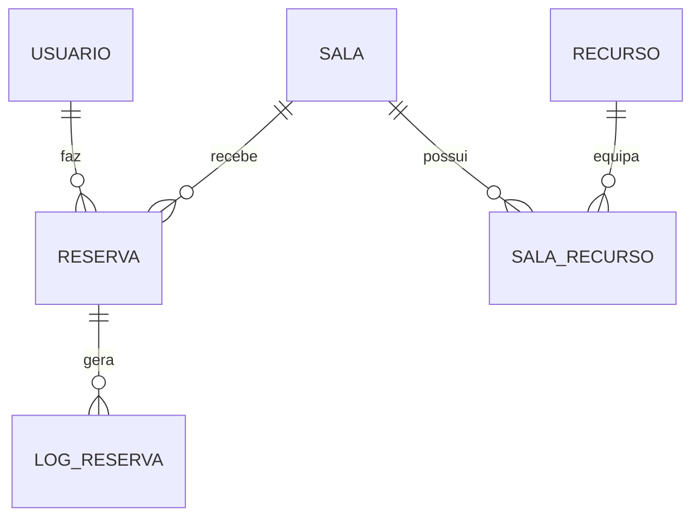

# Plano de Implementação — Sistema de Reserva de Salas e Laboratórios

> **Para quem é este documento**
> 1. **A IA de programação** (Claude Code, Cursor, Copilot etc.) que vai construir o projeto fase a fase.
> 2. **A dupla de alunos**, que usará as "colas de estudo" de cada fase e o banco de perguntas (seção 7) para se preparar para a **avaliação oral individual** (50% da nota).

**Tese do projeto:** a aplicação é uma casca fina. **Toda regra de negócio vive no PostgreSQL.** Se alguma regra (conflito, limite, capacidade, duração) estiver em Python/Java/Node, o projeto está errado.

---

## Painel de progresso

> Atualize este painel ao concluir cada subfase (troque `⬜` por `🟨` = em andamento ou `✅` = concluída). As subfases detalhadas, com checkboxes, estão na seção 4.

**Progresso geral:** 3 / 13 fases · 16 / 69 subfases

| Fase | Tema | Dia | Lidera | Subfases | Status |
|---|---|---|---|---|---|
| 0 | Setup do ambiente | 1 | A | ~~0.1~~ · ~~0.2~~ · ~~0.3~~ · ~~0.4~~ · ~~0.5~~ | ✅ |
| 1 | Modelagem, DER e 3FN | 1–2 | A | ~~1.1~~ · ~~1.2~~ · ~~1.3~~ · ~~1.4~~ · ~~1.5~~ | ✅ |
| 2 | DDL e integridade declarativa | 2–3 | A | ~~2.1~~ · ~~2.2~~ · ~~2.3~~ · ~~2.4~~ · ~~2.5~~ · ~~2.6~~ | ✅ |
| 3 | Seed base | 3 | B | 3.1 · 3.2 · 3.3 · 3.4 · 3.5 | ⬜ |
| 4A | Triggers | 3–4 | A | 4A.1 · 4A.2 · 4A.3 · 4A.4 | ⬜ |
| 4B | Functions e testes de regras | 4–5 | B | 4B.1 · 4B.2 · 4B.3 · 4B.4 · 4B.5 | ⬜ |
| 5 | Views e materialized view | 5 | B | 5.1 · 5.2 · 5.3 · 5.4 · 5.5 | ⬜ |
| 6 | Carga massiva (≥ 10 mil) | 6 | A | 6.1 · 6.2 · 6.3 · 6.4 · 6.5 | ⬜ |
| 7 | Consultas analíticas | 7 | A + B | 7.1 · 7.2 · 7.3 · 7.4 · 7.5 · 7.6 | ⬜ |
| 8 | Índices e `EXPLAIN ANALYZE` | 7–8 | B | 8.1 · 8.2 · 8.3 · 8.4 · 8.5 | ⬜ |
| 9 | Concorrência e transações | 8 | A | 9.1 · 9.2 · 9.3 · 9.4 · 9.5 | ⬜ |
| 10 | Segurança (`app_reservas`) | 8 | A | 10.1 · 10.2 · 10.3 · 10.4 | ⬜ |
| 11 | Aplicação CLI | 9 | B | 11.1 · 11.2 · 11.3 · 11.4 | ⬜ |
| 12 | Documentação e ensaio oral | 10 | A + B | 12.1 · 12.2 · 12.3 · 12.4 · 12.5 | ⬜ |

**Dependências entre fases**



> Fases 7, 8 e 9 dependem só da carga (Fase 6) e podem andar **em paralelo** (um aluno em cada).

---

## Sumário

0. [Como usar este documento](#0-como-usar-este-documento) — regras para a IA, prompt-mestre, divisão da dupla
1. [Decisões de projeto padrão](#1-decisões-de-projeto-padrão)
2. [Stack e estrutura do repositório](#2-stack-e-estrutura-do-repositório)
3. [Cronograma de 10 dias](#3-cronograma-de-10-dias)
4. [Fases de implementação (0 a 12, com subfases)](#4-fases-de-implementação)
5. [Roteiro da apresentação](#5-roteiro-da-apresentação--1520-min)
6. [Matriz de rastreabilidade](#6-matriz-de-rastreabilidade) — requisito → entregável
7. [Banco de perguntas para a avaliação oral](#7-banco-de-perguntas-para-a-avaliação-oral)
8. [Checklist final](#8-checklist-final)
9. [Registro de revisão](#9-registro-de-revisão)

---

## 0. Como usar este documento

### 0.1 Regras invioláveis (valem para todas as fases)

1. **Uma fase por vez, uma subfase por vez.** Ao concluir cada subfase, marcar seus checkboxes e atualizar o **Painel de progresso**. Ao final da fase: executar a **🔍 Sessão de revisão** da fase (todos os comandos listados), mostrar a evidência (saída real do terminal), fazer commit `faseN: descrição` e só então avançar.
2. **SQL puro** em arquivos `.sql` versionados. **Proibido ORM** (SQLAlchemy ORM, Hibernate, Prisma, Sequelize, Django ORM, etc.). Na aplicação, apenas o driver (psycopg 3) com **queries parametrizadas**.
3. A aplicação **não valida** conflito de horário, limite de reservas, capacidade, duração, horário de funcionamento nem existência de usuário/sala. Ela só converte o formato da entrada (texto → data/hora) e **repassa a mensagem de erro do banco**.
4. **Scripts idempotentes:** `make reset` recria o banco do zero, sem intervenção manual.
5. Todo objeto não óbvio recebe `COMMENT ON` ou comentário SQL explicando o **porquê**. Decisões relevantes vão para `docs/decisoes.md`.
6. Mensagens de erro em **português claro**, com SQLSTATE customizado (tabela na Fase 4).
7. Dados de seed **reprodutíveis** (`SELECT setseed(0.42);`).
8. Diante de ambiguidade, **usar o default da seção 1** e registrar em `docs/decisoes.md`. Não parar para perguntar.
9. Ao final de cada fase, gerar `docs/estudo/faseN.md` com uma **cola de estudo** (≤ 10 linhas): o que os dois alunos precisam saber explicar sobre aquela fase.
10. Nunca usar superusuário na aplicação. Nunca commitar senhas (`.env` no `.gitignore`).

### 0.2 Prompt-mestre (colar na IA no início)

```text
Você vai implementar o projeto descrito em plano_implementacao_reservas.md.
Leia o documento inteiro antes de começar. Trabalhe fase por fase e, dentro
de cada fase, subfase por subfase, na ordem. Ao concluir cada subfase, marque
seus checkboxes e atualize o Painel de progresso.
Ao fim de cada fase: (1) execute TODOS os comandos da "🔍 Sessão de revisão"
da fase e mostre a saída real no terminal, (2) crie docs/estudo/faseN.md,
(3) faça commit "faseN: ...", (4) pare e resuma em 5 linhas o que foi feito
antes de seguir.
Restrições: PostgreSQL 16, SQL puro, sem ORM, nenhuma regra de negócio na
aplicação. Comece pela Fase 0.
```

### 0.3 Divisão sugerida da dupla

Como a oral é **individual** e o professor pode perguntar qualquer parte a qualquer integrante, a divisão serve para **produzir**, não para **estudar**. Regra: antes do Dia 9, cada aluno faz **revisão cruzada** (lê e explica em voz alta para o outro) tudo o que o colega construiu.

| Fase | Aluno A | Aluno B |
|---|---|---|
| 0–1 Setup, modelagem, DER, 3FN | ✅ lidera | revisa |
| 2 DDL e integridade | ✅ lidera | revisa |
| 3 Seed base | | ✅ |
| 4A Triggers | ✅ | revisa |
| 4B Functions | revisa | ✅ |
| 5 Views / matview | | ✅ |
| 6 Carga massiva | ✅ | revisa |
| 7 Consultas analíticas | ✅ (Q1–Q3) | ✅ (Q4–Q5) |
| 8 Índices e EXPLAIN | | ✅ |
| 9 Concorrência | ✅ | revisa |
| 10 Segurança (roles) | ✅ | revisa |
| 11 Aplicação CLI | | ✅ |
| 12 Docs e ensaio oral | ✅ | ✅ |

---

## 1. Decisões de projeto padrão

Valores usados quando o enunciado não especifica. Podem ser alterados, mas **qualquer mudança deve ser registrada** em `docs/decisoes.md`.

| Parâmetro | Default | Onde é aplicado |
|---|---|---|
| Funcionamento | todos os dias, 07:00–22:00, fuso `America/Fortaleza` | trigger de regras |
| Duração mínima / máxima | 30 min / 4 h | trigger de regras |
| Reserva dentro de um único dia | sim (não cruza a meia-noite) | trigger de regras (e simplifica as views) |
| Máx. de reservas ativas **futuras** por usuário | 3 | trigger de regras |
| Reserva no passado | proibida | `criar_reserva` |
| Capacidade | `qtd_participantes <= sala.capacidade` | trigger de regras |
| Cancelamento | só o dono ou um ADMIN, e só antes do início | `cancelar_reserva` |
| Status da reserva (ENUM) | `ATIVA`, `CANCELADA` (sem `CONCLUIDA`: é derivável do tempo) | tipo + EXCLUDE |
| Tipos de usuário (ENUM) | `ALUNO`, `PROFESSOR`, `ADMIN` | tipo |
| Tipos de sala (ENUM) | `SALA`, `LABORATORIO` | tipo |
| Intervalo do período | `[)` (fechado no início, aberto no fim) | `tstzrange` |
| Horas disponíveis (ocupação) | dias do mês × 15 h | matview e `taxa_ocupacao` |

---

## 2. Stack e estrutura do repositório

- **PostgreSQL 16** em Docker (`docker-compose.yml`).
- **Python 3.11+** com **psycopg 3** (`psycopg[binary]`), CLI com menu de texto. (Java/JDBC ou Node/pg também servem; o plano não muda.)
- `make` para automatizar.

```text
reservas/
├── README.md
├── docker-compose.yml
├── .env.example
├── .gitignore
├── .gitattributes              # garante LF em *.sh e *.sql para o container Linux
├── Makefile
├── scripts/
│   ├── reset.sh                # roda 99_reset.sql e 0*.sql (usado por make reset ou direto via docker compose)
│   └── test.sh                 # roda tests/test_*.sql (usado por make test ou direto via docker compose)
├── sql/
│   ├── 00_setup.sql            # schema, extensões, roles dono, timezone
│   ├── 01_tipos.sql            # ENUMs e DOMAINs
│   ├── 02_tabelas.sql          # DDL + constraints (inclui EXCLUDE)
│   ├── 03_triggers.sql         # auditoria + regras de negócio
│   ├── 04_functions.sql        # criar_reserva, cancelar_reserva, taxa_ocupacao
│   ├── 05_views.sql            # v_agenda_dia, v_reservas_usuario, mv_ocupacao_mensal
│   ├── 06_seed_base.sql        # salas, recursos, usuários
│   ├── 07_seed_massa.sql       # >= 10 mil reservas
│   ├── 08_indices.sql          # 2 índices (o experimento da Fase 8 faz DROP antes de medir)
│   ├── 09_roles.sql            # app_reservas e GRANTs
│   └── 99_reset.sql            # roda PRIMEIRO no `make reset` (DROP); fica fora do glob 0*.sql
├── analise/
│   ├── consultas_analiticas.sql
│   ├── consultas_analiticas.md # enunciado, SQL, saída e interpretação de cada uma
│   └── explain/                # antes_*.txt, depois_*.txt, analise.md
├── concorrencia/
│   ├── roteiro.md
│   ├── sessao_A.sql
│   ├── sessao_B.sql
│   └── teste_concorrencia.py
├── tests/
│   ├── test_integridade.sql    # Fase 2: constraints declarativas
│   ├── test_regras.sql         # Fase 4: 1 teste por código de erro RS001–RS014
│   └── test_seguranca.sql      # Fase 10: conectado como app_reservas
├── app/
│   ├── main.py
│   ├── db.py
│   └── requirements.txt
└── docs/
    ├── DER_conceitual.png
    ├── DER_logico.md           # Mermaid
    ├── modelagem_3fn.md
    ├── decisoes.md
    ├── roteiro_apresentacao.md
    └── estudo/                 # colas de estudo por fase
```

---

## 3. Cronograma de 10 dias

| Dia | Fases | Subfases do dia | Marco (fim do dia) |
|---|---|---|---|
| 1 | 0 + 1 | 0.1–0.5, 1.1–1.2 | Ambiente no ar, DER e 3FN rascunhados |
| 2 | 1 + 2 | 1.3–1.5, 2.1–2.3 | DDL completo com EXCLUDE funcionando |
| 3 | 2 + 3 + 4A | 2.4–2.6, 3.1–3.5, 4A.1 | Seed base e trigger de auditoria |
| 4 | 4A + 4B | 4A.2–4A.4, 4B.1–4B.2 | Triggers de regra e `criar_reserva`/`cancelar_reserva` |
| 5 | 4B + 5 | 4B.3–4B.5, 5.1–5.4 | Functions, views, matview e testes de regras passando |
| 6 | 6 + 5 | 6.1–6.5, 5.5 | 10 mil+ reservas geradas e views validadas com volume |
| 7 | 7 + 8 | 7.1–7.6, 8.1–8.2 | 5 consultas analíticas e 1º par antes/depois |
| 8 | 8 + 9 + 10 | 8.3–8.5, 9.1–9.5, 10.1–10.4 | EXPLAIN completo, demo de concorrência e role `app_reservas` |
| 9 | 11 | 11.1–11.4 | CLI funcionando ponta a ponta + revisão cruzada |
| 10 | 12 | 12.1–12.5 | Documentação final, ensaio da oral (**buffer**) |

> O Dia 10 é reserva. Se alguma fase atrasar, ele absorve o atraso. Não deixe a documentação e o ensaio para depois dele.

---

## 4. Fases de implementação

> **Formato de cada fase:** cabeçalho (objetivo, dia, quem lidera, dependências) → **subfases** com checkboxes (cada uma termina em um resultado verificável, marcado com ▶) → material de referência (código, tabelas) → **critério de aceite** → **🔍 Sessão de revisão (comandos exatos + saída esperada)** → **cola de estudo**. A última subfase de cada fase é sempre o *fechamento* (rodar a sessão de revisão + cola + commit).

**Equivalência de comandos (com ou sem `make`, Windows PowerShell / Linux / macOS):**

| Ação | Com `make` | Sem `make` (direto via Docker Compose — funciona no PowerShell) |
|---|---|---|
| Subir o banco | `make up` | `docker compose up -d --wait` |
| Recriar tudo (`reset`) | `make reset` | `docker compose exec -T db sh /projeto/scripts/reset.sh` |
| Rodar suíte de testes | `make test` | `docker compose exec -T db sh /projeto/scripts/test.sh` |
| Abrir `psql` interativo | `make psql` | `docker compose exec db psql -U postgres -d reservas` |
| Rodar 1 query de verificação | — | `docker compose exec -T db psql -U postgres -d reservas -c "SQL"` |
| Rodar 1 arquivo `.sql` | — | `docker compose exec -T db psql -v ON_ERROR_STOP=1 -U postgres -d reservas -f /projeto/caminho.sql` |

### Fase 0 — Setup (Dia 1)

**Objetivo:** ambiente reproduzível. · **Lidera:** A · **Depende de:** —

**Subfases**

- [x] **0.1 Repositório** — `git init`, `.gitignore` (inclui `.env`), `.env.example` (`POSTGRES_DB`, `POSTGRES_USER`, `POSTGRES_PASSWORD`, `APP_DB_USER`, `APP_DB_PASSWORD`). ▶ primeiro commit.
- [x] **0.2 Docker** — `docker-compose.yml` com `postgres:16`, volume nomeado e porta 5432. ▶ `make up` sobe o container.
- [x] **0.3 Makefile** — alvos `up`, `down`, `reset`, `psql`, `test`, `app`. O `reset` roda **primeiro** `sql/99_reset.sql` e depois `sql/0*.sql` em ordem (o `99_reset.sql` **não** pode entrar no glob, senão apagaria tudo no fim). ▶ `make reset` executa em banco vazio.
- [x] **0.4 `sql/00_setup.sql`**
  - `CREATE SCHEMA reservas;`
  - `CREATE EXTENSION IF NOT EXISTS btree_gist;`
  - role dono `reservas_owner` (**NOSUPERUSER**), dona de todos os objetos. Roles são **globais ao cluster** (não somem com o `DROP DATABASE`): criar dentro de um bloco `DO` com `IF NOT EXISTS (SELECT 1 FROM pg_roles WHERE rolname = ...)` para manter o script idempotente;
  - `ALTER DATABASE ... SET timezone = 'America/Fortaleza';`
  - `SET search_path = reservas, public;` nos scripts seguintes.
  
  ▶ `SHOW timezone;` correto.
- [x] **0.5 Fechamento** — critério de aceite, `docs/estudo/fase0.md`, commit `fase0: setup`.

**Critério de aceite**
- `make reset` termina sem erro em banco vazio e também em banco já populado.
- `make psql` conecta e `SHOW timezone;` retorna `America/Fortaleza`.

#### 🔍 Sessão de revisão — Fase 0

Execute os comandos abaixo na ordem. A fase só é considerada concluída se **todos** passarem:

```powershell
# 1) Subir o container e aguardar healthcheck
docker compose up -d --wait

# 2) Rodar o reset pela 1ª vez (banco vazio) e pela 2ª vezseguida (prova de idempotência)
docker compose exec -T db sh /projeto/scripts/reset.sh
docker compose exec -T db sh /projeto/scripts/reset.sh

# 3) Conferir timezone e search_path padrão da sessão
docker compose exec -T db psql -U postgres -d reservas -c "SHOW timezone;" -c "SHOW search_path;"

# 4) Conferir se a role reservas_owner existe e NÃO é superusuário (rolsuper = f)
docker compose exec -T db psql -U postgres -d reservas -c "SELECT rolname, rolsuper, rolcanlogin FROM pg_roles WHERE rolname = 'reservas_owner';"

# 5) Conferir se o schema reservas pertence a reservas_owner e se a extensão btree_gist está instalada
docker compose exec -T db psql -U postgres -d reservas -c "SELECT nspname, pg_catalog.pg_get_userbyid(nspowner) AS owner FROM pg_namespace WHERE nspname = 'reservas';" -c "SELECT extname FROM pg_extension WHERE extname = 'btree_gist';"
```

**Resultado esperado na revisão:**
- Passos 1 e 2 terminam com `==> reset concluido sem erros` nas duas execuções.
- Passo 3 retorna `America/Fortaleza` e `reservas, public`.
- Passo 4 retorna `reservas_owner | f | f`.
- Passo 5 retorna `reservas | reservas_owner` e `btree_gist`.

**Cola de estudo:** o que é `btree_gist` e por que ele é necessário (ver Fase 2); por que o dono dos objetos não é superusuário.

---

### Fase 1 — Modelagem, DER e 3FN (Dias 1–2)

**Objetivo:** esquema conceitual e lógico, com justificativa de 3FN. · **Lidera:** A · **Depende de:** 0

**Subfases**

- [x] **1.1 DER conceitual** — `docs/DER_conceitual.png` (brModelo ou draw.io): entidades, atributos, cardinalidades. ▶ imagem no repositório.
- [x] **1.2 DER lógico** — `docs/DER_logico.md`: Mermaid `erDiagram` completo, com PK, FK e tipos. ▶ bate 1:1 com o esqueleto da Fase 2.
- [x] **1.3 Análise de 3FN** — `docs/modelagem_3fn.md`, itens 1–6 abaixo para **cada** tabela. ▶ todo atributo aparece em alguma dependência funcional.
- [x] **1.4 Tabela de `ON DELETE`** — justificativa por FK (tabela pronta na Fase 2) copiada para `docs/modelagem_3fn.md`. ▶ 5 FKs justificadas.
- [x] **1.5 Fechamento** — critério de aceite, `docs/estudo/fase1.md`, commit `fase1: modelagem`.

**Entidades e relacionamentos**



Tabelas: `usuario`, `sala`, `recurso`, `sala_recurso` (N:N, com `quantidade`), `reserva`, `log_reserva` (6 tabelas; mínimo exigido: 5).

**Conteúdo obrigatório de `docs/modelagem_3fn.md`** (subfase 1.3), **para cada tabela**:
1. chave primária e chaves candidatas;
2. dependências funcionais (ex.: `sala.id → codigo, nome, tipo, capacidade`);
3. argumento de 1FN (valores atômicos), 2FN (sem dependência parcial; atenção a `sala_recurso`) e 3FN (sem dependência transitiva);
4. atributos **deliberadamente não armazenados** por serem derivados ou transitivos (nome da sala dentro de `reserva`, status `CONCLUIDA`, etc.);
5. nota sobre `log_reserva`: trilha de auditoria *append-only* com snapshot `jsonb` é desnormalização intencional;
6. discussão de `periodo tstzrange` versus duas colunas `inicio`/`fim`.

**Critério de aceite:** todo atributo de cada tabela aparece na análise de dependências; o DER lógico bate 1:1 com o DDL que será escrito.

#### 🔍 Sessão de revisão — Fase 1

```powershell
# 1) Verificar existência e tamanho não-vazio dos entregáveis de modelagem
Get-Item docs/DER_conceitual.png, docs/DER_logico.md, docs/modelagem_3fn.md, docs/estudo/fase1.md | Select-Object Name, Length

# 2) Verificar se as 6 tabelas estão documentadas no DER lógico e na análise de 3FN
Select-String -Path docs/DER_logico.md -Pattern "USUARIO|SALA|RECURSO|SALA_RECURSO|RESERVA|LOG_RESERVA"
Select-String -Path docs/modelagem_3fn.md -Pattern "1FN|2FN|3FN|ON DELETE|tstzrange"
```

**Resultado esperado na revisão:**
- Todos os 4 arquivos existem e têm conteúdo (`Length > 0`).
- As 6 entidades (`USUARIO`, `SALA`, `RECURSO`, `SALA_RECURSO`, `RESERVA`, `LOG_RESERVA`) aparecem no DER lógico e na justificativa de 1FN/2FN/3FN + tabela de `ON DELETE`.

**Cola de estudo:** explicar 1FN/2FN/3FN com exemplos do próprio esquema; por que `sala_recurso.quantidade` depende da chave inteira.

---

### Fase 2 — DDL e integridade declarativa (Dias 2–3)

**Objetivo:** o banco **impede** dados inválidos mesmo sem triggers. · **Lidera:** A · **Depende de:** 1

**Subfases**

- [x] **2.1 Tipos** (`01_tipos.sql`) — 3 ENUMs e 2 DOMAINs. ▶ `\dT` lista os 5 tipos.
- [x] **2.2 Tabelas de cadastro** (`02_tabelas.sql`) — `usuario`, `sala`, `recurso`, `sala_recurso`, com PK, FK, UNIQUE, NOT NULL, CHECK e `COMMENT ON`. ▶ `\d` de cada tabela confere com o DER lógico.
- [x] **2.3 Tabela `reserva`** — `ck_periodo_valido`, `ck_cancelamento_coerente` e **`EXCLUDE sem_conflito`**. ▶ inserção sobreposta falha com `23P01`.
- [x] **2.4 Tabela `log_reserva`** — append-only, FK `RESTRICT`. ▶ tabela criada.
- [x] **2.5 Testes de integridade** (`tests/test_integridade.sql`) — um caso por item do critério de aceite. ▶ todos os casos com o resultado esperado.
- [x] **2.6 Fechamento** — `docs/estudo/fase2.md`, commit `fase2: ddl e integridade`.

**Tipos** (`01_tipos.sql`)

```sql
CREATE TYPE status_reserva AS ENUM ('ATIVA', 'CANCELADA');
CREATE TYPE tipo_usuario   AS ENUM ('ALUNO', 'PROFESSOR', 'ADMIN');
CREATE TYPE tipo_sala      AS ENUM ('SALA', 'LABORATORIO');

CREATE DOMAIN email_t AS text
  CHECK (VALUE ~* '^[^@\s]+@[^@\s]+\.[^@\s]+$');
CREATE DOMAIN qtd_positiva AS integer
  CHECK (VALUE > 0);
```

**Tabelas** (`02_tabelas.sql`) — esqueleto; a IA completa e comenta

```sql
CREATE TABLE usuario (
  id         bigint GENERATED ALWAYS AS IDENTITY PRIMARY KEY,
  matricula  text         NOT NULL UNIQUE,
  nome       text         NOT NULL CHECK (length(trim(nome)) > 0),
  email      email_t      NOT NULL UNIQUE,
  tipo       tipo_usuario NOT NULL,
  ativo      boolean      NOT NULL DEFAULT true,
  criado_em  timestamptz  NOT NULL DEFAULT now()
);

CREATE TABLE sala (
  id          integer GENERATED ALWAYS AS IDENTITY PRIMARY KEY,
  codigo      text         NOT NULL UNIQUE,
  nome        text         NOT NULL,
  tipo        tipo_sala    NOT NULL,
  capacidade  qtd_positiva NOT NULL,
  ativa       boolean      NOT NULL DEFAULT true
);

CREATE TABLE recurso (
  id    integer GENERATED ALWAYS AS IDENTITY PRIMARY KEY,
  nome  text NOT NULL UNIQUE
);

CREATE TABLE sala_recurso (
  sala_id     integer      NOT NULL REFERENCES sala(id)    ON DELETE CASCADE,
  recurso_id  integer      NOT NULL REFERENCES recurso(id) ON DELETE RESTRICT,
  quantidade  qtd_positiva NOT NULL DEFAULT 1,
  PRIMARY KEY (sala_id, recurso_id)
);

CREATE TABLE reserva (
  id                   bigint GENERATED ALWAYS AS IDENTITY PRIMARY KEY,
  usuario_id           bigint         NOT NULL REFERENCES usuario(id) ON DELETE RESTRICT,
  sala_id              integer        NOT NULL REFERENCES sala(id)    ON DELETE RESTRICT,
  periodo              tstzrange      NOT NULL,
  qtd_participantes    qtd_positiva   NOT NULL,
  finalidade           text,
  status               status_reserva NOT NULL DEFAULT 'ATIVA',
  criada_em            timestamptz    NOT NULL DEFAULT now(),
  cancelada_em         timestamptz,
  motivo_cancelamento  text,

  CONSTRAINT ck_periodo_valido CHECK (
        NOT isempty(periodo) AND NOT lower_inf(periodo) AND NOT upper_inf(periodo)
    AND lower_inc(periodo)   AND NOT upper_inc(periodo)),
  CONSTRAINT ck_cancelamento_coerente CHECK (
        (status = 'CANCELADA') = (cancelada_em IS NOT NULL)),
  CONSTRAINT sem_conflito
    EXCLUDE USING gist (sala_id WITH =, periodo WITH &&)
    WHERE (status = 'ATIVA')
);

CREATE TABLE log_reserva (
  id             bigint GENERATED ALWAYS AS IDENTITY PRIMARY KEY,
  reserva_id     bigint NOT NULL REFERENCES reserva(id) ON DELETE RESTRICT,
  operacao       text   NOT NULL CHECK (operacao IN ('INSERT','UPDATE','CANCELAMENTO')),
  dados_antigos  jsonb,
  dados_novos    jsonb,
  usuario_db     text        NOT NULL DEFAULT session_user,
  data_hora      timestamptz NOT NULL DEFAULT now()
);
```

**Justificativa de `ON DELETE`** (documentar em `docs/modelagem_3fn.md`)

| FK | Ação | Motivo |
|---|---|---|
| `reserva.usuario_id → usuario` | RESTRICT | histórico de reservas não pode sumir; usuário se **desativa** (`ativo=false`) |
| `reserva.sala_id → sala` | RESTRICT | idem; sala se **desativa** |
| `sala_recurso.sala_id → sala` | CASCADE | linha associativa não tem sentido sem a sala |
| `sala_recurso.recurso_id → recurso` | RESTRICT | não apagar recurso em uso |
| `log_reserva.reserva_id → reserva` | RESTRICT | auditoria é imutável; reserva nunca é apagada (cancelar = `UPDATE`) |

**Critério de aceite** (`tests/test_integridade.sql`): cada inserção abaixo **falha** com o erro esperado
- e-mail inválido (violação do DOMAIN);
- `capacidade = 0` (violação do DOMAIN);
- matrícula duplicada (UNIQUE);
- período vazio ou infinito (CHECK);
- `status='CANCELADA'` sem `cancelada_em` (CHECK);
- duas reservas ATIVAS sobrepostas na mesma sala (**EXCLUDE, SQLSTATE 23P01**);
- reserva sobreposta a uma **CANCELADA** (deve ser **aceita**);
- reservas adjacentes 08:00–10:00 e 10:00–12:00 (devem ser **aceitas**: efeito do `[)`).

#### 🔍 Sessão de revisão — Fase 2

```powershell
# 1) Recriar o banco com 01_tipos.sql e 02_tabelas.sql
docker compose exec -T db sh /projeto/scripts/reset.sh

# 2) Listar tipos/domínios e as 6 tabelas criadas no schema reservas
docker compose exec -T db psql -U postgres -d reservas -c "\dT+ reservas.*" -c "\dt+ reservas.*"

# 3) Inspecionar constraints de reserva (confirmar ck_periodo_valido, ck_cancelamento_coerente e sem_conflito EXCLUDE USING gist)
docker compose exec -T db psql -U postgres -d reservas -c "\d reservas.reserva"

# 4) Executar a suíte de testes de integridade declarativa (testa todos os 8 itens do critério de aceite)
docker compose exec -T db psql -v ON_ERROR_STOP=1 -U postgres -d reservas -f /projeto/tests/test_integridade.sql
```

**Resultado esperado na revisão:**
- `\dT+` lista os 3 ENUMs (`status_reserva`, `tipo_sala`, `tipo_usuario`) e 2 DOMAINs (`email_t`, `qtd_positiva`).
- `\dt+` lista as 6 tabelas com dono `reservas_owner`.
- `\d reservas.reserva` exibe `"sem_conflito" EXCLUDE USING gist (sala_id WITH =, periodo WITH &&) WHERE (status = 'ATIVA'::status_reserva)`.
- `test_integridade.sql` imprime `NOTICE: OK ...` para cada uma das 8 verificações e termina com código 0 (deixando as tabelas limpas ao final via `ROLLBACK`).

**Cola de estudo:** como o EXCLUDE funciona; por que `btree_gist`; por que `WHERE (status='ATIVA')`; por que `[)`; ENUM versus DOMAIN versus tabela de domínio.

---

### Fase 3 — Seed base (Dia 3)

**Objetivo:** dados suficientes para testar e demonstrar. · **Lidera:** B · **Depende de:** 2

**Subfases** (`06_seed_base.sql`, determinístico)

- [ ] **3.1 Salas** — **≥ 20 salas** (≈ 12 `SALA` + ≈ 8 `LABORATORIO`), capacidades variadas (20 a 80). Reservar uma **sala de demonstração** (ex.: `id = 5`) que a carga futura da Fase 6 não ocupa. ▶ `count(*)` ≥ 20.
- [ ] **3.2 Recursos e `sala_recurso`** — **≥ 8 recursos** (Projetor, Quadro branco, Ar-condicionado, Computadores, Lousa digital, Bancadas, Sistema de som, Kit de robótica); `sala_recurso` com ≥ 60 linhas (laboratórios com `Computadores` e quantidade). ▶ contagens conferem.
- [ ] **3.3 Usuários gerados** — **≥ 150 usuários** (≈ 120 ALUNO, 25 PROFESSOR, 5 ADMIN) com nomes brasileiros plausíveis gerados a partir de arrays + `generate_series`. ▶ contagem por `tipo`.
- [ ] **3.4 Usuários de demonstração fixos** — ids conhecidos, listados no README: 1 ADMIN, 1 PROFESSOR, 2 ALUNOS. ▶ `SELECT` pelos ids retorna os 4.
- [ ] **3.5 Fechamento** — critério de aceite, `docs/estudo/fase3.md`, commit `fase3: seed base`.

**Critério de aceite:** `SELECT count(*)` por tabela confere com o mínimo; relatório de `sala` agrupado por `tipo`.

#### 🔍 Sessão de revisão — Fase 3

```powershell
# 1) Recriar o banco e carregar o seed base (06_seed_base.sql)
docker compose exec -T db sh /projeto/scripts/reset.sh

# 2) Verificar contagens mínimas (>= 20 salas, >= 8 recursos, >= 60 sala_recurso, >= 150 usuários)
docker compose exec -T db psql -U postgres -d reservas -c "SELECT 'sala' AS tabela, count(*) FROM sala UNION ALL SELECT 'recurso', count(*) FROM recurso UNION ALL SELECT 'sala_recurso', count(*) FROM sala_recurso UNION ALL SELECT 'usuario', count(*) FROM usuario;"

# 3) Distribuição de salas por tipo e usuários por tipo
docker compose exec -T db psql -U postgres -d reservas -c "SELECT tipo, count(*), min(capacidade), max(capacidade) FROM sala GROUP BY tipo;" -c "SELECT tipo, count(*) FROM usuario GROUP BY tipo ORDER BY tipo;"

# 4) Conferir os 4 usuários de demonstração fixos (IDs 1..4) e a sala de demonstração (ID 5)
docker compose exec -T db psql -U postgres -d reservas -c "SELECT id, matricula, nome, tipo FROM usuario WHERE id IN (1,2,3,4) ORDER BY id;" -c "SELECT id, codigo, nome, tipo, capacidade FROM sala WHERE id = 5;"
```

**Resultado esperado na revisão:**
- `sala >= 20`, `recurso >= 8`, `sala_recurso >= 60`, `usuario >= 150`.
- Salas divididas entre `SALA` e `LABORATORIO`; usuários divididos entre `ALUNO`, `PROFESSOR` e `ADMIN`.
- Usuários de demonstração (IDs 1 a 4) e sala de demonstração (ID 5) presentes e identificados.

**Cola de estudo:** `setseed`/`random()`; por que o seed é reprodutível.

---

### Fase 4 — Triggers e functions (Dias 3–5)

**Objetivo:** todas as regras de negócio dentro do banco. · **Lidera:** A (4A) e B (4B) · **Depende de:** 3

**Subfases**

*4A — Triggers (`03_triggers.sql`)*
- [ ] **4A.1 Auditoria** — `fn_audit_reserva` + `trg_audit_reserva` (AFTER, `SECURITY DEFINER`). ▶ um `INSERT` manual gera linha `INSERT` em `log_reserva`.
- [ ] **4A.2 Regras simples** — `fn_regras_reserva` com passos 1–5: reativação proibida (RS009), duração (RS005), horário/mesmo dia (RS006), capacidade (RS007). ▶ cada regra rejeita um caso manual.
- [ ] **4A.3 Limite de futuras com lock** — passo 6 (RS008) com `FOR NO KEY UPDATE`. ▶ 4ª reserva futura do mesmo usuário falha.
- [ ] **4A.4 Fechamento 4A** — commit `fase4a: triggers`.

*4B — Functions (`04_functions.sql`) e testes*
- [ ] **4B.1 `criar_reserva`** — validações RS001–RS004 e captura de `23P01` → RS010. ▶ retorna `id`; conflito devolve RS010.
- [ ] **4B.2 `cancelar_reserva`** — `FOR UPDATE`, RS011–RS014, log `CANCELAMENTO`. ▶ cancelamento válido gera log com `dados_antigos` e `dados_novos`.
- [ ] **4B.3 `taxa_ocupacao`** — `STABLE`, `SECURITY DEFINER`, mês normalizado. ▶ valor entre 0 e 100 para uma sala/mês.
- [ ] **4B.4 `tests/test_regras.sql`** — 1 bloco `DO` por SQLSTATE + casos positivos; ligado ao `make test`. ▶ `make test` imprime todos os OK.
- [ ] **4B.5 Fechamento** — `docs/estudo/fase4.md`, commit `fase4b: functions e testes`.

#### Códigos de erro (SQLSTATE customizados)

Usar classe `RS` (iniciais fora das classes reservadas do padrão) com `RAISE EXCEPTION ... USING ERRCODE`.

| SQLSTATE | Significado | Quem levanta |
|---|---|---|
| RS001 | período inválido (fim ≤ início, nulo) | `criar_reserva` |
| RS002 | reserva no passado | `criar_reserva` |
| RS003 | usuário inexistente ou inativo | `criar_reserva` |
| RS004 | sala inexistente ou inativa | `criar_reserva` |
| RS005 | duração fora do mínimo/máximo | trigger regras |
| RS006 | fora do horário de funcionamento ou cruza o dia | trigger regras |
| RS007 | capacidade excedida | trigger regras |
| RS008 | limite de reservas futuras atingido | trigger regras |
| RS009 | transição de status inválida (reativar cancelada) | trigger regras |
| RS010 | conflito de horário | `criar_reserva` (captura `23P01`) |
| RS011 | reserva não encontrada | `cancelar_reserva` |
| RS012 | sem permissão para cancelar | `cancelar_reserva` |
| RS013 | reserva já cancelada | `cancelar_reserva` |
| RS014 | reserva já iniciada | `cancelar_reserva` |

#### 4A. Triggers (`03_triggers.sql`)

**(a) Auditoria** — `AFTER INSERT OR UPDATE`, `FOR EACH ROW`

```sql
CREATE OR REPLACE FUNCTION fn_audit_reserva() RETURNS trigger
LANGUAGE plpgsql SECURITY DEFINER SET search_path = reservas, pg_temp
AS $$
DECLARE v_op text;
BEGIN
  IF TG_OP = 'INSERT' THEN
    INSERT INTO log_reserva (reserva_id, operacao, dados_novos)
    VALUES (NEW.id, 'INSERT', to_jsonb(NEW));
  ELSE
    v_op := CASE WHEN OLD.status = 'ATIVA' AND NEW.status = 'CANCELADA'
                 THEN 'CANCELAMENTO' ELSE 'UPDATE' END;
    INSERT INTO log_reserva (reserva_id, operacao, dados_antigos, dados_novos)
    VALUES (NEW.id, v_op, to_jsonb(OLD), to_jsonb(NEW));
  END IF;
  RETURN NULL;  -- valor ignorado em trigger AFTER
END $$;

CREATE TRIGGER trg_audit_reserva
  AFTER INSERT OR UPDATE ON reserva
  FOR EACH ROW EXECUTE FUNCTION fn_audit_reserva();
```

**(b) Regras de negócio** — `BEFORE INSERT OR UPDATE`, `FOR EACH ROW`

```sql
CREATE OR REPLACE FUNCTION fn_regras_reserva() RETURNS trigger
LANGUAGE plpgsql
AS $$
DECLARE
  c_tz          constant text     := 'America/Fortaleza';
  c_abre        constant time     := '07:00';
  c_fecha       constant time     := '22:00';
  c_dur_min     constant interval := interval '30 minutes';
  c_dur_max     constant interval := interval '4 hours';
  c_max_futuras constant int      := 3;
  v_cap int; v_qtd int;
  v_ini timestamp; v_fim timestamp; v_dur interval;
BEGIN
  -- 1) cancelada não pode ser reativada
  IF TG_OP = 'UPDATE' AND OLD.status = 'CANCELADA' AND NEW.status <> 'CANCELADA' THEN
    RAISE EXCEPTION 'A reserva % já foi cancelada e não pode ser reativada.', OLD.id
      USING ERRCODE = 'RS009';
  END IF;

  -- 2) regras valem apenas para reservas ATIVAS
  IF NEW.status <> 'ATIVA' THEN RETURN NEW; END IF;

  v_ini := lower(NEW.periodo) AT TIME ZONE c_tz;
  v_fim := upper(NEW.periodo) AT TIME ZONE c_tz;
  v_dur := upper(NEW.periodo) - lower(NEW.periodo);

  -- 3) duração
  IF v_dur < c_dur_min OR v_dur > c_dur_max THEN
    RAISE EXCEPTION 'Duração inválida (%). A reserva deve durar entre % e %.',
      v_dur, c_dur_min, c_dur_max USING ERRCODE = 'RS005';
  END IF;

  -- 4) horário de funcionamento e mesmo dia
  IF v_ini::date <> v_fim::date OR v_ini::time < c_abre OR v_fim::time > c_fecha THEN
    RAISE EXCEPTION 'Fora do horário de funcionamento (%–%) ou atravessa a meia-noite.',
      c_abre, c_fecha USING ERRCODE = 'RS006';
  END IF;

  -- 5) capacidade
  SELECT capacidade INTO v_cap FROM sala WHERE id = NEW.sala_id;
  IF NEW.qtd_participantes > v_cap THEN
    RAISE EXCEPTION 'Capacidade excedida: a sala comporta % pessoas e foram informadas %.',
      v_cap, NEW.qtd_participantes USING ERRCODE = 'RS007';
  END IF;

  -- 6) limite de reservas ativas futuras (com lock p/ evitar corrida entre sessões)
  IF lower(NEW.periodo) > now() THEN
    PERFORM 1 FROM usuario WHERE id = NEW.usuario_id FOR NO KEY UPDATE;
    SELECT count(*) INTO v_qtd
      FROM reserva
     WHERE usuario_id = NEW.usuario_id AND status = 'ATIVA'
       AND lower(periodo) > now() AND id IS DISTINCT FROM NEW.id;
    IF v_qtd >= c_max_futuras THEN
      RAISE EXCEPTION 'Limite atingido: o usuário já possui % reservas futuras ativas (máximo %).',
        v_qtd, c_max_futuras USING ERRCODE = 'RS008';
    END IF;
  END IF;

  RETURN NEW;
END $$;

CREATE TRIGGER trg_regras_reserva
  BEFORE INSERT OR UPDATE ON reserva
  FOR EACH ROW EXECUTE FUNCTION fn_regras_reserva();
```

> **Por que o `FOR NO KEY UPDATE`?** Sem ele, duas sessões do mesmo usuário contam "2 reservas", ambas inserem e o usuário termina com 4 (anomalia de *write skew*). O lock serializa as reservas do mesmo usuário. `NO KEY UPDATE` (e não `UPDATE`) evita conflito com o `FOR KEY SHARE` que o PostgreSQL toma na checagem da FK. Alternativa: `pg_advisory_xact_lock`. Isso será **demonstrado na Fase 9**.

#### 🔍 Sessão de revisão — Fase 4A (Triggers)

```powershell
# 1) Aplicar 03_triggers.sql e verificar se os 2 triggers estão ligados na tabela reserva
docker compose exec -T db sh /projeto/scripts/reset.sh
docker compose exec -T db psql -U postgres -d reservas -c "SELECT tgname, tgenabled FROM pg_trigger WHERE tgrelid = 'reservas.reserva'::regclass AND NOT tgisinternal ORDER BY tgname;"

# 2) Teste rápido de auditoria (INSERT + CANCELAMENTO) e de regra (duração > 4h → RS005) dentro de transação revertida
docker compose exec -T db psql -v ON_ERROR_STOP=1 -U postgres -d reservas -c "BEGIN; INSERT INTO reserva (usuario_id, sala_id, periodo, qtd_participantes, finalidade) VALUES (1, 1, tstzrange((current_date+5+time '08:00') AT TIME ZONE 'America/Fortaleza', (current_date+5+time '10:00') AT TIME ZONE 'America/Fortaleza', '[)'), 10, 'Teste 4A'); SELECT operacao, dados_novos->>'status' AS status_novo FROM log_reserva ORDER BY id DESC LIMIT 1; ROLLBACK;"
```

**Resultado esperado na revisão 4A:**
- `pg_trigger` lista `trg_audit_reserva` e `trg_regras_reserva` com `tgenabled = O` (ativos).
- A inserção de teste gera um registro `INSERT | ATIVA` em `log_reserva` e o `ROLLBACK` limpa o teste.

#### 4B. Functions (`04_functions.sql`)

**`criar_reserva(p_usuario_id bigint, p_sala_id int, p_inicio timestamptz, p_fim timestamptz, p_qtd int, p_finalidade text DEFAULT NULL) RETURNS bigint`**

```sql
CREATE OR REPLACE FUNCTION criar_reserva(
  p_usuario_id bigint, p_sala_id integer,
  p_inicio timestamptz, p_fim timestamptz,
  p_qtd integer, p_finalidade text DEFAULT NULL)
RETURNS bigint
LANGUAGE plpgsql SECURITY DEFINER SET search_path = reservas, pg_temp
AS $$
DECLARE v_id bigint;
BEGIN
  IF p_inicio IS NULL OR p_fim IS NULL OR p_fim <= p_inicio THEN
    RAISE EXCEPTION 'Período inválido: o fim deve ser posterior ao início.' USING ERRCODE='RS001';
  END IF;
  IF p_inicio < now() THEN
    RAISE EXCEPTION 'Não é possível reservar um horário que já passou.' USING ERRCODE='RS002';
  END IF;
  IF NOT EXISTS (SELECT 1 FROM usuario WHERE id = p_usuario_id AND ativo) THEN
    RAISE EXCEPTION 'Usuário % inexistente ou inativo.', p_usuario_id USING ERRCODE='RS003';
  END IF;
  IF NOT EXISTS (SELECT 1 FROM sala WHERE id = p_sala_id AND ativa) THEN
    RAISE EXCEPTION 'Sala % inexistente ou inativa.', p_sala_id USING ERRCODE='RS004';
  END IF;

  INSERT INTO reserva (usuario_id, sala_id, periodo, qtd_participantes, finalidade)
  VALUES (p_usuario_id, p_sala_id, tstzrange(p_inicio, p_fim, '[)'), p_qtd, p_finalidade)
  RETURNING id INTO v_id;
  RETURN v_id;

EXCEPTION
  WHEN exclusion_violation THEN   -- 23P01, vinda do EXCLUDE
    RAISE EXCEPTION 'Conflito de horário: a sala % já está reservada em parte do período pedido.',
      p_sala_id USING ERRCODE = 'RS010';
END $$;
```

Notas obrigatórias para o código final e a oral:
- A function roda **dentro da transação do chamador**; o bloco `EXCEPTION` cria uma **subtransação** (savepoint implícito) e desfaz o que a function fez antes do erro. Se o enunciado exigir `COMMIT` interno, usar `PROCEDURE` + `CALL`; registrar a escolha em `docs/decisoes.md`.
- O trigger de regras **também** dispara no `INSERT` (as duas camadas se complementam).

**`cancelar_reserva(p_reserva_id bigint, p_usuario_id bigint, p_motivo text DEFAULT NULL) RETURNS void`** (`SECURITY DEFINER`, mesmo `search_path`)
1. `SELECT ... FROM reserva WHERE id = p_reserva_id FOR UPDATE` (evita duplo cancelamento concorrente).
2. Não achou → `RS011`. Já cancelada → `RS013`. Já iniciada (`lower(periodo) <= now()`) → `RS014`.
3. Se `p_usuario_id` não é o dono **e** não é `ADMIN` → `RS012`.
4. `UPDATE reserva SET status='CANCELADA', cancelada_em=now(), motivo_cancelamento=p_motivo WHERE id=...` (o trigger de auditoria registra `CANCELAMENTO`).

**`taxa_ocupacao(p_sala_id int, p_mes date) RETURNS numeric`** (`STABLE`, `SECURITY DEFINER`, mesmo `search_path` — sem isso a role `app_reservas`, que não lê `reserva`, receberia `permission denied` ao chamá-la)
- Normalizar o mês: `date_trunc('month', p_mes::timestamp)` (**cuidado:** `date_trunc` com argumento `date` devolve `timestamptz` e depende do fuso da sessão).
- `taxa = horas reservadas ATIVAS no mês / (dias do mês × 15) × 100`, com 2 casas decimais.
- Sala inexistente → `RAISE EXCEPTION` claro.
- Deve coincidir com a coluna equivalente da matview (teste de consistência na Fase 5).

**Critério de aceite da Fase 4:** `tests/test_regras.sql` com **um teste por SQLSTATE** (RS001…RS014), cada um usando bloco `DO $$ ... EXCEPTION WHEN SQLSTATE 'RS0xx' THEN RAISE NOTICE 'OK RS0xx'; END $$;`, mais: reserva válida criada; log com `INSERT`; cancelamento gera log `CANCELAMENTO` com `dados_antigos` e `dados_novos`. `make test` imprime todos os OK.

#### 🔍 Sessão de revisão — Fase 4B (Functions + Regras completas)

```powershell
# 1) Recriar o banco com triggers e functions
docker compose exec -T db sh /projeto/scripts/reset.sh

# 2) Conferir as 3 functions criadas, seus donos (reservas_owner) e SECURITY DEFINER (prosecdef = t)
docker compose exec -T db psql -U postgres -d reservas -c "SELECT proname, pg_get_userbyid(proowner) AS owner, prosecdef, provolatile FROM pg_proc WHERE pronamespace = 'reservas'::regnamespace AND proname IN ('criar_reserva','cancelar_reserva','taxa_ocupacao') ORDER BY proname;"

# 3) Rodar a suíte de testes de regras (valida RS001 a RS014 + criação + cancelamento + auditoria + taxa_ocupacao)
docker compose exec -T db psql -v ON_ERROR_STOP=1 -U postgres -d reservas -f /projeto/tests/test_regras.sql
```

**Resultado esperado na revisão 4B:**
- As 3 functions existem, pertencem a `reservas_owner` e têm `prosecdef = t` (`taxa_ocupacao` com `provolatile = s` = `STABLE`).
- `test_regras.sql` imprime `NOTICE: OK RS001` até `NOTICE: OK RS014`, além de `OK criacao/auditoria/cancelamento/taxa_ocupacao`, sem nenhum erro não capturado.

**Cola de estudo:** BEFORE vs AFTER; `OLD`/`NEW`/`TG_OP`; `SECURITY DEFINER` e por que fixar `search_path`; function vs procedure; o que um `RAISE EXCEPTION` desfaz; `session_user` vs `current_user`.

---

### Fase 5 — Views e materialized view (Dia 5)

**Objetivo:** leitura simples para a aplicação. · **Lidera:** B · **Depende de:** 4B (validação final depende de 6)

**Subfases** (`05_views.sql`)

- [ ] **5.1 `v_agenda_dia`** ▶ `SELECT ... WHERE sala_id = ? AND dia = ?` retorna as reservas ativas do dia.
- [ ] **5.2 `v_reservas_usuario`** ▶ consulta por `usuario_id` mostra coluna `futura` correta.
- [ ] **5.3 `mv_ocupacao_mensal` + índice UNIQUE `(sala_id, mes)`** ▶ `REFRESH ... CONCURRENTLY` executa.
- [ ] **5.4 (Opcional) `v_salas_recursos`** ▶ menu da CLI pode listar IDs válidos.
- [ ] **5.5 Fechamento** — *executar após a Fase 6* (precisa de volume): critério de aceite, `docs/estudo/fase5.md`, commit `fase5: views`.

**`v_agenda_dia`** — reservas ATIVAS com sala e responsável, já com colunas de fácil filtro:
`sala_id, sala_codigo, sala_nome, dia (date local), hora_inicio (time), hora_fim (time), reserva_id, responsavel, finalidade, qtd_participantes`.
A aplicação faz apenas `WHERE sala_id = %s AND dia = %s ORDER BY hora_inicio`.

**`v_reservas_usuario`** — `usuario_id, reserva_id, sala_codigo, inicio, fim, status, futura (boolean)`; ordenada do mais recente ao mais antigo.

**`mv_ocupacao_mensal`** (materialized view)
- Colunas: `sala_id, sala_codigo, mes (date, 1º dia), total_reservas, horas_reservadas, taxa_ocupacao_pct`.
- Todas as salas aparecem em todos os meses, inclusive com 0 reserva (`CROSS JOIN` de salas × meses + `LEFT JOIN` em reservas ATIVAS).
- **Índice UNIQUE em `(sala_id, mes)`** (necessário para `REFRESH MATERIALIZED VIEW CONCURRENTLY`).
- Rotina de atualização documentada (`REFRESH ... CONCURRENTLY`); mencionar `pg_cron` como evolução.

> A regra "reserva não cruza a meia-noite" (Fase 4) é o que permite agrupar por `date_trunc('month', lower(periodo) AT TIME ZONE 'America/Fortaleza')` sem se preocupar com reservas que atravessam dois meses.

**Opcional (apoio de UX, não é uma 5ª funcionalidade):** `v_salas_recursos` (id, código, tipo, capacidade, recursos agregados) para o menu mostrar IDs válidos. Se usar, avisar o professor.

**Critério de aceite**
- As três consultas retornam dados coerentes após o seed (Fase 6).
- `SELECT taxa_ocupacao(s, m)` == coluna `taxa_ocupacao_pct` da matview, para uma amostra de pares (sala, mês).
- `REFRESH MATERIALIZED VIEW CONCURRENTLY mv_ocupacao_mensal;` funciona.

#### 🔍 Sessão de revisão — Fase 5

```powershell
# 1) Recriar o banco com 05_views.sql e listar views e materialized views
docker compose exec -T db sh /projeto/scripts/reset.sh
docker compose exec -T db psql -U postgres -d reservas -c "\dv+ reservas.*" -c "\dm+ reservas.*"

# 2) Testar REFRESH MATERIALIZED VIEW CONCURRENTLY (exige o índice UNIQUE em (sala_id, mes))
docker compose exec -T db psql -U postgres -d reservas -c "REFRESH MATERIALIZED VIEW CONCURRENTLY mv_ocupacao_mensal;"

# 3) (Executar na subfase 5.5, após a Fase 6) Verificar se taxa_ocupacao(sala, mes) coincide 100% com mv_ocupacao_mensal
docker compose exec -T db psql -U postgres -d reservas -c "SELECT count(*) AS divergencias FROM mv_ocupacao_mensal mv WHERE mv.taxa_ocupacao_pct <> taxa_ocupacao(mv.sala_id, mv.mes) LIMIT 20;"
```

**Resultado esperado na revisão:**
- `\dv+` lista `v_agenda_dia` e `v_reservas_usuario` (e `v_salas_recursos` se criada); `\dm+` lista `mv_ocupacao_mensal`.
- `REFRESH MATERIALIZED VIEW CONCURRENTLY` executa sem erro.
- A consulta de divergências entre `mv_ocupacao_mensal.taxa_ocupacao_pct` e `taxa_ocupacao(sala_id, mes)` retorna `0`.

**Cola de estudo:** view vs matview; dado "velho" na matview; por que `CONCURRENTLY` exige UNIQUE; por que a agenda é view e a ocupação é matview.

---

### Fase 6 — Carga massiva ≥ 10 mil reservas (Dia 6)

**Objetivo:** volume realista, **sem violar nenhuma regra**. · **Lidera:** A · **Depende de:** 5 (até 5.4)

**Subfases** (`07_seed_massa.sql`)

- [ ] **6.1 Histórico (passado)** — candidatas `sala × dia × slot` dos últimos 365 dias, sorteio com `random() < p` (esqueleto abaixo). ▶ inserção sem erro de trigger/EXCLUDE.
- [ ] **6.2 Ajuste de volume** — calibrar `p` até **≥ 12.000** linhas. ▶ `count(*)` ≥ 12.000.
- [ ] **6.3 Reservas futuras** — ~100 nos próximos 30 dias, ≤ 3 por usuário, **excluindo os usuários de demonstração e a sala de demonstração** (Fase 3), para que as demos da Fase 9 não esbarrem em RS008/RS010 indevidos. ▶ nenhum usuário com > 3 futuras.
- [ ] **6.4 Cancelamentos** — ~8% via `UPDATE` para `CANCELADA` com `cancelada_em` coerente. ▶ `log_reserva` contém `CANCELAMENTO`.
- [ ] **6.5 Validação e fechamento** — queries do critério de aceite, `ANALYZE`, `REFRESH`, `docs/estudo/fase6.md`, commit `fase6: carga massiva`. Em seguida, fechar a subfase **5.5**.

**Estratégia (conflito-free por construção)**
- Gerar candidatas = `sala × dia × slot`, onde os slots são disjuntos por sala (início às 07, 09, 11, 13, 15, 17, 19 h; duração de 60 ou 120 min). Assim **nunca há sobreposição**, e o EXCLUDE funciona como verificação, não como obstáculo.
- Selecionar candidatas com `random() < p` e ajustar `p` para ficar com **≥ 12.000** linhas (margem sobre os 10 mil).
- Histórico: últimos 365 dias → reservas passadas **não contam** como "futuras" para o limite de 3.
- Futuras: ~100 reservas nos próximos 30 dias, com usuário escolhido por `row_number() % n_usuarios` para garantir **≤ 3 por usuário**.
- ~8% canceladas: inserir como ATIVA e depois `UPDATE` para `CANCELADA` (com `cancelada_em` coerente); isso também popula o log com `CANCELAMENTO`.
- `criada_em` definido explicitamente, alguns dias antes do início, para não ficar tudo com a data do seed.
- O trigger de regras **fica ligado** durante a carga: é a prova de que os dados respeitam as regras. (Se algo exigir `DISABLE TRIGGER`, justificar em `docs/decisoes.md` e rodar uma query de validação depois.)

Esqueleto:

```sql
SELECT setseed(0.42);

WITH slots(h) AS (VALUES (7),(9),(11),(13),(15),(17),(19)),
dias AS (
  SELECT d::date AS dia
  FROM generate_series(current_date - 365, current_date - 1, interval '1 day') AS d
),
u AS (SELECT array_agg(id ORDER BY id) AS ids FROM usuario WHERE tipo <> 'ADMIN'),
cand AS MATERIALIZED (
  SELECT s.id AS sala_id, s.capacidade, d.dia, sl.h,
         (ARRAY[60,120])[1 + floor(random()*2)::int] AS dur_min,
         random() AS r_sel, random() AS r_usr, random() AS r_qtd, random() AS r_ant
  FROM sala s CROSS JOIN dias d CROSS JOIN slots sl
)
INSERT INTO reserva (usuario_id, sala_id, periodo, qtd_participantes, finalidade, criada_em)
SELECT u.ids[1 + floor(c.r_usr * array_length(u.ids,1))::int],
       c.sala_id,
       tstzrange(ini, ini + make_interval(mins => c.dur_min), '[)'),
       1 + floor(c.r_qtd * c.capacidade)::int,
       'Reserva gerada (seed)',
       ini - make_interval(days => 1 + floor(c.r_ant*14)::int)
FROM cand c CROSS JOIN u
CROSS JOIN LATERAL (SELECT ((c.dia + make_interval(hours => c.h))::timestamp
                            AT TIME ZONE 'America/Fortaleza') AS ini) t
WHERE c.r_sel < 0.22;   -- AJUSTAR p até count(*) >= 12000
```

> `AS MATERIALIZED` impede o planner de "inlinar" a CTE e reavaliar `random()` mais de uma vez.

**Critério de aceite**
- `SELECT count(*) FROM reserva;` ≥ 10.000.
- Prova de ausência de conflito (deve retornar 0):
  ```sql
  SELECT count(*) FROM reserva a JOIN reserva b
    ON a.sala_id = b.sala_id AND a.id < b.id AND a.periodo && b.periodo
   AND a.status = 'ATIVA' AND b.status = 'ATIVA';
  ```
- Nenhum usuário com mais de 3 reservas ativas futuras.
- `ANALYZE reserva; REFRESH MATERIALIZED VIEW mv_ocupacao_mensal;`
- `log_reserva` tem ≥ 1 linha por reserva.

#### 🔍 Sessão de revisão — Fase 6

```powershell
# 1) Recriar o banco com a carga massiva (07_seed_massa.sql) — os triggers e o EXCLUDE ficam ATIVOS durante toda a carga
docker compose exec -T db sh /projeto/scripts/reset.sh

# 2) Conferir volume total (>= 10.000), divisão por status e registros no log_reserva
docker compose exec -T db psql -U postgres -d reservas -c "SELECT status, count(*) FROM reserva GROUP BY ROLLUP(status);" -c "SELECT operacao, count(*) FROM log_reserva GROUP BY ROLLUP(operacao);"

# 3) Prova matemática de ZERO conflitos de horário entre reservas ATIVAS (deve retornar 0)
docker compose exec -T db psql -U postgres -d reservas -c "SELECT count(*) AS conflitos FROM reserva a JOIN reserva b ON a.sala_id = b.sala_id AND a.id < b.id AND a.periodo && b.periodo AND a.status = 'ATIVA' AND b.status = 'ATIVA';"

# 4) Prova de que nenhum usuário tem > 3 reservas futuras ativas (deve retornar 0) e que a sala/usuários de demo estão livres no futuro
docker compose exec -T db psql -U postgres -d reservas -c "SELECT count(*) AS violacoes_limite FROM (SELECT usuario_id FROM reserva WHERE status = 'ATIVA' AND lower(periodo) > now() GROUP BY usuario_id HAVING count(*) > 3) t;" -c "SELECT count(*) AS reservas_futuras_demo FROM reserva WHERE lower(periodo) > now() AND (sala_id = 5 OR usuario_id IN (1,2,3,4));"
```

**Resultado esperado na revisão:**
- Total de reservas `>= 10.000` (alvo `>= 12.000`), com ~8% `CANCELADA` e `log_reserva >= count(reserva)`.
- `conflitos = 0`, `violacoes_limite = 0` e `reservas_futuras_demo = 0`.

**Cola de estudo:** `generate_series`, `CROSS JOIN LATERAL`, `random()` e `setseed`; por que a geração é conflito-free; por que passado não conta como "futuro".

---

### Fase 7 — Cinco consultas analíticas (Dia 7)

**Objetivo:** consultas documentadas que cobrem JOIN, GROUP BY/HAVING, subconsulta, CTE e window function. · **Lidera:** A (Q1–Q3) e B (Q4–Q5) · **Depende de:** 6

Arquivos: `analise/consultas_analiticas.sql` (SQL puro) e `analise/consultas_analiticas.md`.

**Subfases** (cada Qn: SQL + saída real + interpretação no `.md`)

- [ ] **7.1 Q1** — JOIN + GROUP BY + HAVING
- [ ] **7.2 Q2** — subconsulta escalar no HAVING
- [ ] **7.3 Q3** — CTE + `FILTER`
- [ ] **7.4 Q4** — `RANK()` + `LAG()`
- [ ] **7.5 Q5** — CTE + `DENSE_RANK()`
- [ ] **7.6 Fechamento** — conferir tempos (< 2 s) e coerência entre consultas, `docs/estudo/fase7.md`, commit `fase7: consultas analiticas`.

| # | Pergunta de negócio | Técnicas |
|---|---|---|
| Q1 | Quais usuários têm **mais de 10** reservas ativas nos últimos 90 dias e quantas horas somam? | `JOIN` + `GROUP BY` + `HAVING` |
| Q2 | Quais salas tiveram, em um mês, taxa de ocupação **acima da média** de todas as salas? | **subconsulta** escalar no `HAVING` (+ `JOIN` com `sala`) |
| Q3 | Distribuição de reservas por dia da semana × faixa horária e **% de cancelamento** em cada célula | **CTE** + `count(*) FILTER (WHERE ...)` |
| Q4 | **Ranking mensal** das salas por horas reservadas e variação em relação ao mês anterior | **window:** `RANK() OVER (PARTITION BY mes ORDER BY horas DESC)` + `LAG()` |
| Q5 | **Top 3 usuários** de cada tipo (ALUNO/PROFESSOR) por horas reservadas | CTE + `DENSE_RANK() OVER (PARTITION BY tipo ...)` + `JOIN` |

Cada consulta no `.md` segue o modelo:
1. **Pergunta de negócio** (1 frase);
2. **SQL** comentado;
3. **Saída real** (primeiras linhas, copiada do `psql`);
4. **Interpretação** (o que o resultado diz);
5. **Técnicas usadas** e por quê.

**Critério de aceite:** as 5 consultas rodam em < 2 s; a matriz acima cobre os cinco requisitos; os resultados são coerentes entre si (ex.: horas de Q4 batem com a matview).

#### 🔍 Sessão de revisão — Fase 7

```powershell
# 1) Executar todas as 5 consultas analíticas com cronômetro (\timing on)
docker compose exec -T db psql -v ON_ERROR_STOP=1 -U postgres -d reservas -c "\timing on" -f /projeto/analise/consultas_analiticas.sql

# 2) Verificar se analise/consultas_analiticas.md documenta Q1..Q5 com pergunta, SQL, saída e interpretação
Select-String -Path analise/consultas_analiticas.md -Pattern "^## Q[1-5]|HAVING|FILTER|RANK|DENSE_RANK|LAG"
```

**Resultado esperado na revisão:**
- As 5 consultas executam sem erro, retornam linhas coerentes e cada uma leva `< 2000 ms`.
- `analise/consultas_analiticas.md` contém as 5 seções completas.

**Cola de estudo:** `WHERE` vs `HAVING`; window vs `GROUP BY`; `RANK` vs `DENSE_RANK` vs `ROW_NUMBER`; CTE inlined a partir do PG12; `FILTER`.

---

### Fase 8 — Índices e `EXPLAIN ANALYZE` (Dias 7–8)

**Objetivo:** 2 índices, com comparação **antes/depois** documentada. · **Lidera:** B · **Depende de:** 6

**Subfases**

- [ ] **8.1 Preparação** — escolher as 2 consultas-alvo (fora do alcance do índice do EXCLUDE); decidir se usa `reservas_bench`; `DROP INDEX IF EXISTS` dos índices de `08_indices.sql` (o `make reset` já os cria). ▶ consultas e decisão registradas em `analise/explain/analise.md`.
- [ ] **8.2 Índice 1** — procedimento passos 1–4. ▶ `antes_1.txt` e `depois_1.txt` com planos diferentes.
- [ ] **8.3 Índice 2** — idem. ▶ `antes_2.txt` e `depois_2.txt`.
- [ ] **8.4 Análise e prints** — passos 5–6. ▶ `analise.md` completo + screenshots.
- [ ] **8.5 Fechamento** — `docs/estudo/fase8.md`, commit `fase8: indices e explain`.

> **Armadilha:** o `EXCLUDE` já cria um índice GiST parcial em `(sala_id, periodo) WHERE status='ATIVA'`. Consultas que filtram por `sala_id` + período + `status='ATIVA'` **já usam** esse índice, então o "antes" não seria "sem índice". Escolha consultas que ele **não cobre**.

**Candidatos** (a IA escolhe, mede e justifica)

| Índice | Consulta-alvo | Hipótese |
|---|---|---|
| `CREATE INDEX idx_reserva_usuario_futuras ON reserva (usuario_id, (lower(periodo))) WHERE status = 'ATIVA';` | contagem do trigger de limite e `v_reservas_usuario` filtrada por usuário | `Seq Scan` → `Index Scan`/`Index Only Scan`; também acelera o `INSERT` (o trigger roda a contagem a cada linha) |
| `CREATE INDEX idx_reserva_inicio ON reserva (lower(periodo));` **ou** `USING gist (periodo)` | consultas por período **sem** `sala_id` (ex.: reservas de um mês em todas as salas; base do Q3/Q4) | `Seq Scan` → `Bitmap Index Scan` |

**Procedimento (repetir para cada índice)**
1. `ANALYZE reserva;` e garantir que **o índice ainda não existe**.
2. `EXPLAIN (ANALYZE, BUFFERS) <consulta>;` → rodar 3×, registrar a última (cache aquecido) em `analise/explain/antes_N.txt`.
3. `CREATE INDEX ...; ANALYZE reserva;`
4. Repetir o `EXPLAIN` → `analise/explain/depois_N.txt`.
5. Registrar em `analise/explain/analise.md`: tipo de nó (Seq Scan → Index/Bitmap), tempo de planejamento e execução, `Rows Removed by Filter`, `Buffers` lidos, linhas estimadas × reais, **custo de escrita** do índice (espaço em disco via `pg_relation_size`, impacto no INSERT) e **quando o planner não usaria** o índice (baixa seletividade).
6. Incluir os **prints** (screenshots do terminal) além do texto.

> Com apenas 10 mil linhas o planner pode preferir `Seq Scan` mesmo com índice. Para evidência mais forte, criar um banco de teste separado (`reservas_bench`) com ~500 mil reservas apenas para o experimento, e **documentar essa escolha**.

**Critério de aceite:** dois pares antes/depois com prints, plano diferente e análise escrita em linguagem própria dos alunos.

#### 🔍 Sessão de revisão — Fase 8

```powershell
# 1) Conferir se os 2 índices extras estão criados após o reset e ver o tamanho de cada um
docker compose exec -T db sh /projeto/scripts/reset.sh
docker compose exec -T db psql -U postgres -d reservas -c "SELECT indexname, pg_size_pretty(pg_relation_size(indexname::regclass)) AS tamanho, indexdef FROM pg_indexes WHERE schemaname = 'reservas' AND tablename = 'reserva' ORDER BY indexname;"

# 2) Conferir os arquivos de evidência antes/depois e a análise escrita
Get-Item analise/explain/antes_1.txt, analise/explain/depois_1.txt, analise/explain/antes_2.txt, analise/explain/depois_2.txt, analise/explain/analise.md | Select-Object Name, Length

# 3) Confirmar mudança de plano (Seq Scan no antes -> Index Scan / Index Only Scan / Bitmap Index Scan no depois)
Select-String -Path analise/explain/antes_*.txt, analise/explain/depois_*.txt -Pattern "Seq Scan|Index Scan|Index Only Scan|Bitmap Index Scan|Execution Time"
```

**Resultado esperado na revisão:**
- Os 2 índices aparecem em `pg_indexes` (além da PK e do `sem_conflito`).
- Os arquivos `antes_1.txt`/`depois_1.txt` e `antes_2.txt`/`depois_2.txt` mostram a transição de `Seq Scan` para scan via índice e redução de tempo/buffers.

**Cola de estudo:** ler um `EXPLAIN ANALYZE` linha a linha; B-tree vs GiST; índice parcial; índice sobre expressão (`lower(periodo)`); custo × benefício.

---

### Fase 9 — Concorrência e transações (Dia 8)

**Objetivo:** provar que o banco impede reserva dupla sob concorrência e documentar o roteiro. · **Lidera:** A · **Depende de:** 6 (e 10 para o Cenário 3, que conecta como `app_reservas`)

Arquivos: `concorrencia/roteiro.md`, `sessao_A.sql`, `sessao_B.sql`, `teste_concorrencia.py`.

**Subfases**

- [ ] **9.1 Cenário 1** — mesmo horário, duas sessões, variantes `COMMIT` e `ROLLBACK`. ▶ saídas reais copiadas para `roteiro.md`.
- [ ] **9.2 Evidência de espera** — `pg_stat_activity` na Sessão C. ▶ `wait_event_type = Lock` registrado.
- [ ] **9.3 Cenário 2** — corrida no limite de 3, com e sem o lock. ▶ os dois resultados registrados.
- [ ] **9.4 Cenário 3** — `teste_concorrencia.py` com 20 threads, 10 execuções. ▶ 10/10 verdes.
- [ ] **9.5 Fechamento** — conclusão em `roteiro.md`, `docs/estudo/fase9.md`, commit `fase9: concorrencia`.

#### Cenário 1 — Mesmo horário, duas sessões (manual, 3 terminais `psql`)

| Passo | Sessão A | Sessão B | Resultado esperado |
|---|---|---|---|
| 1 | `BEGIN;` | | |
| 2 | `SELECT criar_reserva(1, 5, current_date+10+time '14:00', current_date+10+time '16:00', 20, 'A');` | | retorna um `id`; **ainda sem COMMIT** |
| 3 | | `BEGIN; SELECT criar_reserva(2, 5, current_date+10+time '15:00', current_date+10+time '17:00', 10, 'B');` | **B fica bloqueada** (não retorna) |
| 4 | *(Sessão C)* `SELECT pid, state, wait_event_type, wait_event, left(query,60) FROM pg_stat_activity WHERE datname = current_database();` | | B com `wait_event_type = Lock`, `wait_event = transactionid` |
| 5a | `COMMIT;` | | B recebe **`RS010: Conflito de horário...`** |
| 5b *(variante)* | `ROLLBACK;` | | B **conclui** com sucesso, pois o horário ficou livre |

**Por que B espera?** O índice do EXCLUDE encontra uma linha conflitante **ainda não confirmada**; o PostgreSQL precisa esperar o desfecho da transação de A para saber se o conflito é real.

#### Cenário 2 — Corrida no limite de 3 reservas

1. Usuário X com 2 reservas futuras ativas.
2. Sessões A e B tentam, ao mesmo tempo, a 3ª e a 4ª reserva de X (salas/horários diferentes, sem conflito entre si).
3. **Com** o `FOR NO KEY UPDATE` do trigger: uma passa, a outra recebe `RS008`.
4. **Demonstração didática:** comentar temporariamente a linha do lock → ambas passam (X fica com 4). Restaurar o lock e registrar os dois resultados.

#### Cenário 3 — Teste automatizado (`teste_concorrencia.py`)
- N = 20 threads, cada uma com **conexão própria** como `app_reservas`, sincronizadas por `threading.Barrier`, todas pedindo a **mesma sala/horário**.
- Asserções: **exatamente 1 sucesso** e 19 erros `RS010`; `count(*)` de reservas ATIVAS sobrepostas no horário = 1.
- Rodar 10 vezes; todas devem passar.

**Critério de aceite:** `roteiro.md` com comandos, saídas reais e conclusão; teste automatizado verde; o aluno consegue reproduzir o Cenário 1 sozinho, em ≤ 3 minutos.

#### 🔍 Sessão de revisão — Fase 9

```powershell
# 1) Recriar o banco limpo para os testes de concorrência
docker compose exec -T db sh /projeto/scripts/reset.sh

# 2) Rodar o teste automatizado de concorrência (20 threads simultâneas disputando o mesmo horário + corrida do limite de 3 reservas)
python concorrencia/teste_concorrencia.py

# 3) Conferir no banco que restou exatamente 1 reserva ativa no slot disputado e que ninguém ultrapassou 3 reservas futuras
docker compose exec -T db psql -U postgres -d reservas -c "SELECT count(*) AS violacoes_limite FROM (SELECT usuario_id FROM reserva WHERE status = 'ATIVA' AND lower(periodo) > now() GROUP BY usuario_id HAVING count(*) > 3) t;"

# 4) Verificar se os scripts das sessões A e B e o roteiro documentado existem
Get-Item concorrencia/roteiro.md, concorrencia/sessao_A.sql, concorrencia/sessao_B.sql, concorrencia/teste_concorrencia.py | Select-Object Name, Length
```

**Resultado esperado na revisão:**
- `python concorrencia/teste_concorrencia.py` executa todas as baterias com `1 sucesso` e `19 conflitos RS010` por bateria, terminando com código 0.
- `violacoes_limite = 0`.
- `concorrencia/roteiro.md` contém a saída real do `pg_stat_activity` (`wait_event_type = Lock`, `wait_event = transactionid`).

**Cola de estudo:** READ COMMITTED e snapshot por comando; por que o EXCLUDE funciona em qualquer nível de isolamento; MVCC (leitores não bloqueiam escritores); `40P01` (deadlock) e `40001` (serialização).

---

### Fase 10 — Segurança: role `app_reservas` (Dia 8)

**Objetivo:** a aplicação só consegue **executar functions** e **ler views**. · **Lidera:** A · **Depende de:** 4B e 5

**Subfases**

- [ ] **10.1 `09_roles.sql`** — criação idempotente da role (bloco `DO` com `IF NOT EXISTS`, pois roles sobrevivem ao `DROP DATABASE`), `REVOKE`s e `GRANT`s. Senha vinda do `.env`, nunca fixa no script versionado. ▶ `make reset` roda 2× sem erro.
- [ ] **10.2 Revisão de donos e `SECURITY DEFINER`** — conferir os 3 "pontos que a IA não pode esquecer" (inclui `taxa_ocupacao`). ▶ `\df+` mostra dono `reservas_owner` e *Security* `definer`.
- [ ] **10.3 `tests/test_seguranca.sql`** — tabela de tentativas + conferência declarativa, ligado ao `make test`. ▶ todas as linhas com o resultado esperado.
- [ ] **10.4 Fechamento** — `docs/estudo/fase10.md`, commit `fase10: seguranca`.

```sql
-- 09_roles.sql (executado pelo dono/administrador)
-- criação idempotente: DO $$ BEGIN IF NOT EXISTS (SELECT 1 FROM pg_roles WHERE rolname='app_reservas') THEN ... END IF; END $$;
CREATE ROLE app_reservas LOGIN PASSWORD 'trocar-via-env'
  NOSUPERUSER NOCREATEDB NOCREATEROLE;
GRANT CONNECT ON DATABASE reservas TO app_reservas;

REVOKE ALL ON SCHEMA reservas FROM PUBLIC;
GRANT  USAGE ON SCHEMA reservas TO app_reservas;

REVOKE ALL ON ALL TABLES IN SCHEMA reservas FROM PUBLIC, app_reservas;
REVOKE EXECUTE ON ALL FUNCTIONS IN SCHEMA reservas FROM PUBLIC;  -- default é EXECUTE p/ PUBLIC!

GRANT SELECT ON v_agenda_dia, v_reservas_usuario, mv_ocupacao_mensal TO app_reservas;
GRANT EXECUTE ON FUNCTION
  criar_reserva(bigint, integer, timestamptz, timestamptz, integer, text),
  cancelar_reserva(bigint, bigint, text),
  taxa_ocupacao(integer, date)
TO app_reservas;

ALTER ROLE app_reservas SET search_path = reservas;
ALTER ROLE app_reservas SET timezone = 'America/Fortaleza';
```

**Pontos que a IA não pode esquecer**
- `criar_reserva`, `cancelar_reserva` e `taxa_ocupacao` são `SECURITY DEFINER` com `SET search_path = reservas, pg_temp`, e pertencem a `reservas_owner` (**não** superusuário).
- Views executam com os privilégios do **dono** (padrão; sem `security_invoker`), por isso `app_reservas` lê a view sem ter acesso à tabela.
- O trigger de auditoria é `SECURITY DEFINER` para gravar em `log_reserva`; ele registra `session_user` (login real), não `current_user` (dono).

**Critério de aceite** (script `tests/test_seguranca.sql`, conectado **como `app_reservas`**)

| Tentativa | Esperado |
|---|---|
| `SELECT * FROM reserva;` | `permission denied for table reserva` |
| `INSERT INTO reserva ...` | `permission denied` |
| `UPDATE`/`DELETE` em qualquer tabela | `permission denied` |
| `SELECT * FROM log_reserva;` | `permission denied` |
| `SELECT * FROM v_agenda_dia LIMIT 1;` | **funciona** |
| `SELECT criar_reserva(...)` | **funciona** |
| `SELECT taxa_ocupacao(...)` | **funciona** |
| `CREATE TABLE x (...)` | `permission denied for schema` |

E uma conferência declarativa:
`SELECT has_table_privilege('app_reservas','reservas.reserva','SELECT');` → `f`; `SELECT has_function_privilege('app_reservas','reservas.criar_reserva(bigint,integer,timestamptz,timestamptz,integer,text)','EXECUTE');` → `t`.

#### 🔍 Sessão de revisão — Fase 10

```powershell
# 1) Rodar o reset 2x seguidas (prova que 09_roles.sql é idempotente)
docker compose exec -T db sh /projeto/scripts/reset.sh
docker compose exec -T db sh /projeto/scripts/reset.sh

# 2) Executar o script de teste de segurança conectado COMO app_reservas
docker compose exec -T db psql -v ON_ERROR_STOP=1 -U app_reservas -d reservas -f /projeto/tests/test_seguranca.sql

# 3) Prova direta de bloqueio: tentar ler a tabela reserva como app_reservas (DEVE falhar com permission denied)
docker compose exec -T db psql -U app_reservas -d reservas -c "SELECT * FROM reserva LIMIT 1;"

# 4) Prova direta de permissão: ler a view v_agenda_dia e chamar taxa_ocupacao como app_reservas (DEVEM funcionar)
docker compose exec -T db psql -U app_reservas -d reservas -c "SELECT * FROM v_agenda_dia LIMIT 3;" -c "SELECT taxa_ocupacao(1, current_date);"
```

**Resultado esperado na revisão:**
- Passo 2 imprime `NOTICE: OK ...` para todas as checagens de privilégio (`has_table_privilege = f` para as 6 tabelas; `has_table_privilege = t` para as views; `has_function_privilege = t` para as 3 functions).
- Passo 3 falha com `ERROR: permission denied for table reserva`.
- Passo 4 retorna linhas de `v_agenda_dia` e o valor numérico de `taxa_ocupacao`.

**Cola de estudo:** princípio do menor privilégio; `SECURITY DEFINER` e seus riscos; `search_path` hijacking; por que revogar `EXECUTE` de `PUBLIC`; limitação: a app informa o `usuario_id` (sem autenticação real). Evolução possível: Row-Level Security.

---

### Fase 11 — Aplicação CLI (Dia 9)

**Objetivo:** casca fina, com 4 opções e nenhuma regra de negócio. · **Lidera:** B · **Depende de:** 9 e 10

**Subfases** (`app/`)

- [ ] **11.1 Conexão** — `db.py` lê o `.env`, conecta como `app_reservas`; `requirements.txt` com `psycopg[binary]`. ▶ conexão abre e `SHOW timezone` = `America/Fortaleza`.
- [ ] **11.2 Menu e 4 funcionalidades** — `main.py` com as 4 chamadas da tabela abaixo, apenas *parsing* de formato. ▶ cada opção retorna dados.
- [ ] **11.3 Transação e erros** — função `chamar` (commit/rollback, `e.diag.message_primary`). ▶ erros RS005–RS010 aparecem com a mensagem do banco.
- [ ] **11.4 Fechamento** — fluxo completo do critério de aceite, `grep` sem lógica de negócio, revisão cruzada da dupla, `docs/estudo/fase11.md`, commit `fase11: cli`.

| Menu | Chamada SQL (parametrizada) |
|---|---|
| 1. Agenda da sala no dia | `SELECT hora_inicio, hora_fim, responsavel, finalidade, qtd_participantes FROM v_agenda_dia WHERE sala_id = %s AND dia = %s ORDER BY hora_inicio` |
| 2. Criar reserva | `SELECT criar_reserva(%s, %s, %s, %s, %s, %s)` |
| 3. Cancelar reserva | `SELECT cancelar_reserva(%s, %s, %s)` |
| 4. Ocupação mensal | `SELECT sala_codigo, total_reservas, horas_reservadas, taxa_ocupacao_pct FROM mv_ocupacao_mensal WHERE mes = %s ORDER BY taxa_ocupacao_pct DESC` |

**Regras da aplicação**
- Conecta **como `app_reservas`**, via variáveis de ambiente (`.env`), nunca com superusuário.
- Só faz *parsing de formato* (texto → `date`/`timestamp`; "2026-03" → `2026-03-01`). **Nada** de comparar horários, contar reservas ou checar capacidade.
- **Fuso:** garantir `timezone = America/Fortaleza` na sessão (já definido no `ALTER ROLE`), para que "14:00" digitado seja 14:00 local.
- **Transação:** psycopg 3 abre transação implícita; **chamar `conn.commit()` após `criar_reserva`/`cancelar_reserva`** (senão nada persiste) e `conn.rollback()` no erro.
- **Erros:** capturar `psycopg.Error` (SQLSTATEs customizados `RSxxx` chegam como erro genérico) e exibir `e.diag.message_primary`.

```python
import psycopg

def chamar(conn, sql, params=()):
    try:
        with conn.cursor() as cur:
            cur.execute(sql, params)
            linhas = cur.fetchall() if cur.description else None
        conn.commit()
        return linhas
    except psycopg.Error as e:
        conn.rollback()
        print(f"✖ {e.diag.message_primary}")   # mensagem escrita no banco, apenas repassada
        return None
```

**Critério de aceite**
- Fluxo completo: criar → ver na agenda → tentar criar conflitante (erro do banco exibido) → cancelar → ver sumir da agenda → ver relatório.
- Cada erro RS005–RS010 é provocado pela CLI e mostra a mensagem do banco.
- `grep -rniE "capacidade|conflito|limite|duracao" app/` não encontra **lógica** de negócio (apenas textos de menu).
- Nenhum `f"...{variavel}..."` dentro de SQL (sempre `%s` + parâmetros).

#### 🔍 Sessão de revisão — Fase 11

```powershell
# 1) Garantir que o código da aplicação não usa ORM nem interpola variáveis em SQL
Select-String -Path app/*.py -Pattern "sqlalchemy|peewee|tortoise|django|prisma|f"".*SELECT|f'.*SELECT|\.format\(.*SELECT"

# 2) Inspecionar ocorrências de palavras de negócio em app/ (só podem aparecer em rótulos de menu/input, nunca em if/validação)
Select-String -Path app/*.py -Pattern "capacidade|conflito|limite|duracao"

# 3) Teste ponta a ponta não-interativo da CLI (ou script de smoke test que exercita as 4 opções + erro RS010 + cancelamento)
python app/main.py --smoke-test
```

**Resultado esperado na revisão:**
- Passo 1 não retorna nenhuma linha (zero ORM, zero SQL interpolado).
- Passo 2 mostra que a aplicação não faz `if` de regra de negócio.
- Passo 3 executa as 4 funcionalidades conectando como `app_reservas`: cria reserva → lista na agenda → tenta criar conflitante (exibe `✖ Conflito de horário...` vindo do banco) → cancela → lista ocupação mensal.

**Cola de estudo:** por que a app não valida nada; SQL injection e queries parametrizadas; autocommit × transação implícita; o que mudaria na app se a duração máxima passasse a ser 3 h (resposta: nada).

---

### Fase 12 — Documentação, ensaio e congelamento (Dia 10)

**Objetivo:** entrega reproduzível e dupla preparada para a oral. · **Lidera:** A + B · **Depende de:** todas

**Subfases**

- [ ] **12.1 README** — pré-requisitos, `make reset`, `make test`, `make app`, usuários e salas de demonstração, links para a documentação. ▶ um colega segue o README sem ajuda.
- [ ] **12.2 Decisões e estudo** — revisar `docs/decisoes.md` (cada decisão com "alternativa considerada" e "por que esta"); consolidar `docs/estudo/*.md` em um único roteiro de estudo (a IA concatena e remove repetições). ▶ arquivos revisados.
- [ ] **12.3 Roteiro da apresentação** — escrever `docs/roteiro_apresentacao.md` (seção 5). ▶ ensaio cronometrado ≤ 20 min.
- [ ] **12.4 Ensaio oral cruzado** — cada aluno responde 15 perguntas da seção 7 sorteadas pelo colega, **sem consultar o código**, e depois com ele aberto; cada um executa sozinho H2, H9 e uma alteração de regra. ▶ lacunas revisadas nas colas.
- [ ] **12.5 Congelamento** — rodar `make reset && make test` do zero em uma máquina limpa (ou container novo); criar tag git `entrega`. ▶ tag criada.

**Critério de aceite:** repositório clonado em máquina limpa sobe com dois comandos e todos os testes passam.

#### 🔍 Sessão de revisão — Fase 12 (Revisão geral de entrega)

```powershell
# 1) Reset completo do zero + execução de toda a suíte de testes (integridade, regras e segurança)
docker compose exec -T db sh /projeto/scripts/reset.sh
docker compose exec -T db sh /projeto/scripts/test.sh

# 2) Teste de concorrência automatizado + smoke test da aplicação CLI
python concorrencia/teste_concorrencia.py
python app/main.py --smoke-test

# 3) Conferir se todas as 13 colas de estudo e documentos obrigatórios existem
Get-ChildItem docs/estudo/fase*.md, docs/DER_*, docs/modelagem_3fn.md, docs/decisoes.md, docs/roteiro_apresentacao.md, README.md | Select-Object Name, Length

# 4) Verificar que o repositório está limpo e sem arquivos sensíveis (.env fora do git)
git status --short
git ls-files .env
```

**Resultado esperado na revisão:**
- `reset.sh`, `test.sh`, `teste_concorrencia.py` e `app/main.py --smoke-test` terminam todos com código 0.
- Todos os documentos e colas de estudo estão presentes.
- `git ls-files .env` retorna vazio.

---

## 5. Roteiro da apresentação (≈ 15–20 min)

| Min | Conteúdo | Quem conduz |
|---|---|---|
| 0–2 | Arquitetura: "casca fina + banco inteligente"; DER e 3FN | A |
| 2–5 | Tour do DDL: ENUM, DOMAIN, CHECK, FK/ON DELETE, **EXCLUDE**; mostrar a violação ao vivo | A |
| 5–8 | Triggers (auditoria e regras) e functions: provocar 3 erros diferentes direto no `psql` | B |
| 8–10 | Views e matview; `REFRESH`; consulta de uma analítica com window function | B |
| 10–13 | `EXPLAIN ANALYZE` antes/depois (prints) | B |
| 13–16 | **Demo de concorrência** com duas sessões + `pg_stat_activity` | A |
| 16–18 | Segurança: conectar como `app_reservas`, mostrar `permission denied` e o que funciona | A |
| 18–20 | CLI: fluxo completo com erros vindos do banco | B |

> Como a oral é individual, **os papéis acima não limitam as perguntas**: o professor pode perguntar a qualquer um sobre qualquer parte.

---

## 6. Matriz de rastreabilidade

| Requisito do enunciado | Entregável | Fase |
|---|---|---|
| ≥ 5 tabelas | `usuario, sala, recurso, sala_recurso, reserva, log_reserva` | 2 |
| DER conceitual e lógico + 3FN | `docs/DER_*`, `docs/modelagem_3fn.md` | 1 |
| PK, FK com ON DELETE justificado, UNIQUE, NOT NULL, CHECK | `02_tabelas.sql` + tabela de ON DELETE | 2 |
| ≥ 1 DOMAIN ou ENUM | `status_reserva`, `tipo_*`, `email_t`, `qtd_positiva` | 2 |
| `EXCLUDE USING gist` + `tstzrange` | constraint `sem_conflito` | 2 |
| Trigger de auditoria | `trg_audit_reserva` | 4A |
| Trigger de regra de negócio | `trg_regras_reserva` | 4A |
| `criar_reserva` | `04_functions.sql` | 4B |
| `taxa_ocupacao(sala, mes)` | `04_functions.sql` | 4B |
| `RAISE EXCEPTION` com mensagens claras | tabela RS001–RS014 + `tests/test_regras.sql` | 4A, 4B |
| `v_agenda_dia`, `v_reservas_usuario`, matview | `05_views.sql` | 5 |
| ≥ 10 mil reservas com `generate_series`/`random()` | `07_seed_massa.sql` | 6 |
| 5 consultas (JOIN, GROUP BY/HAVING, subconsulta, CTE, window) | `analise/consultas_analiticas.*` | 7 |
| 2 índices + `EXPLAIN ANALYZE` antes/depois | `08_indices.sql`, `analise/explain/` | 8 |
| Duas sessões simultâneas sem reserva dupla | `concorrencia/roteiro.md` + teste | 9 |
| Role `app_reservas` (EXECUTE + SELECT em views) | `09_roles.sql`, `tests/test_seguranca.sql` | 10 |
| App com 4 funcionalidades, sem regra de negócio | `app/` | 11 |
| Banco populado para demonstração | `06_seed_base.sql`, `07_seed_massa.sql` | 3, 6 |

---

## 7. Banco de perguntas para a avaliação oral

Formato: **P** = pergunta provável · **R** = resposta-guia (o que o aluno precisa saber dizer, em palavras próprias). As respostas são ponto de partida: **explique sempre com exemplos do *seu* projeto.**

### 7.1 Modelagem e normalização

**P1. Por que o esquema está na 3FN?**
R: Todo atributo não-chave depende da chave, da chave inteira e de nada além da chave. Ex.: `sala.capacidade` depende só de `sala.id`; `reserva` guarda `sala_id` e não o nome/capacidade da sala; `sala_recurso.quantidade` depende do par `(sala_id, recurso_id)` completo.

**P2. Por que `sala_recurso` é uma tabela separada?**
R: Relação N:N. Colocar recursos como lista em `sala` violaria a 1FN (valores não atômicos) e geraria redundância e anomalias de atualização.

**P3. Se eu adicionasse `nome_usuario` na tabela `reserva`, o que violaria?**
R: A 3FN: `reserva.id → usuario_id → nome` é dependência transitiva. Trazeria anomalia de atualização (mudou o nome, tem de alterar N linhas) e risco de inconsistência.

**P4. `tstzrange` viola a 1FN?**
R: Não: no PostgreSQL o range é um tipo escalar com operadores próprios, tratado como um valor atômico. A alternativa são duas colunas `inicio/fim`, mas aí o `EXCLUDE` precisaria de uma expressão `tstzrange(inicio, fim)`. Escolhi range pela clareza e por permitir `&&`.

**P5. `log_reserva` com `jsonb` está em 3FN?**
R: É uma trilha de auditoria *append-only*; o snapshot guarda o estado **naquele momento**, não deve mudar quando a origem muda. Desnormalização intencional e justificada.

**P6. Por que ENUM para status e não uma tabela de domínio?**
R: ENUM é simples, tipado e ordenado, bom para conjunto pequeno e estável. Tabela de domínio dá mais flexibilidade (metadados, adicionar/remover sem DDL de tipo), ao custo de um JOIN/FK. `ALTER TYPE ... ADD VALUE` existe, mas remover valor é complicado.

**P7. Diferença entre DOMAIN e CHECK direto na coluna?**
R: DOMAIN define a regra uma vez e a reutiliza (`qtd_positiva` em capacidade, quantidade e participantes); CHECK direto fica preso a uma coluna.

**P8. Chave substituta (identity) ou natural (matrícula)?**
R: Identity para PK (estável, pequena, imune a mudança); matrícula e e-mail continuam `UNIQUE NOT NULL` como chaves candidatas.

**P9. Justifique os `ON DELETE` escolhidos.**
R: `RESTRICT` em reserva→usuário/sala e log→reserva, para preservar histórico (desativa-se em vez de apagar); `CASCADE` em `sala_recurso→sala`, porque a linha associativa não faz sentido sem a sala.

### 7.2 Integridade declarativa e EXCLUDE

**P10. Como funciona o `EXCLUDE USING gist (sala_id WITH =, periodo WITH &&)`?**
R: Cria um índice GiST. A cada INSERT/UPDATE o banco procura linhas existentes com mesma `sala_id` **e** período sobreposto; se achar, rejeita com SQLSTATE `23P01` (`exclusion_violation`). Um UNIQUE é o caso particular em que todos os operadores são `=`.

**P11. Para que serve `btree_gist`?**
R: O GiST não tem operador de igualdade padrão para tipos escalares como inteiro. A extensão adiciona classes de operadores para que `sala_id WITH =` possa conviver com `periodo WITH &&` no mesmo índice.

**P12. Por que `WHERE (status = 'ATIVA')`?**
R: Reserva cancelada libera o horário. A cláusula torna o índice **parcial**: só reservas ativas disputam espaço.

**P13. Por que não fazer `SELECT` para ver se está livre e depois `INSERT`?**
R: Condição de corrida (*check-then-act*): duas sessões consultam, ambas veem livre, ambas inserem. A constraint é verificada de forma atômica pelo banco, sem janela entre checar e gravar.

**P14. Por que o intervalo é `[)`?**
R: Meio-aberto: 08–10 e 10–12 não se sobrepõem (o limite superior é exclusivo). Se fosse `[]`, haveria falso conflito no horário de troca.

**P15. O que impede um período vazio ou infinito?**
R: O `CHECK ck_periodo_valido` (`NOT isempty`, `NOT lower_inf`, `NOT upper_inf`, bounds `[)`).

**P16. O que garante `ck_cancelamento_coerente`?**
R: `(status='CANCELADA') = (cancelada_em IS NOT NULL)`: cancelada **sempre** tem data de cancelamento e ativa **nunca** tem.

### 7.3 Triggers e functions

**P17. Por que a auditoria é AFTER e a regra de negócio é BEFORE?**
R: A regra precisa **barrar** a linha antes de gravar (e pode alterar `NEW`). A auditoria só deve registrar algo que realmente foi gravado, e depende do `id` já existente (FK de `log_reserva`).

**P18. `FOR EACH ROW` ou `FOR EACH STATEMENT`?**
R: `ROW`, porque preciso de `OLD`/`NEW` por linha. `STATEMENT` dispara uma vez por comando e não enxerga linhas individuais.

**P19. Como o trigger de auditoria distingue cancelamento de update comum?**
R: Compara `OLD.status = 'ATIVA'` com `NEW.status = 'CANCELADA'`; se for essa transição, grava `CANCELAMENTO`.

**P20. Por que `RETURN NULL` no trigger AFTER e `RETURN NEW` no BEFORE?**
R: Em AFTER o retorno é ignorado. Em BEFORE FOR EACH ROW, o retorno é a linha que será gravada; `NULL` cancelaria a operação silenciosamente.

**P21. O que é `SECURITY DEFINER` e por que fixou o `search_path`?**
R: A function executa com os privilégios do **dono**. Sem `search_path` fixo, um usuário poderia criar objeto homônimo em outro schema e sequestrar a execução (*search_path hijacking*).

**P22. Function ou procedure? Qual a diferença?**
R: Procedure (`CALL`) pode controlar transação (`COMMIT`/`ROLLBACK`) e não retorna valor; function (`SELECT`) roda **dentro** da transação do chamador e retorna valor. Usei function porque quero atomicidade e o `id` retornado.

**P23. A `criar_reserva` é transacional? O que acontece num erro?**
R: Tudo o que ela fez antes do erro é desfeito. O bloco `EXCEPTION` usa uma subtransação. Se o chamador estava em transação explícita, ela fica "abortada" até `ROLLBACK`.

**P24. Por que códigos `RSxxx` em vez do `P0001` padrão?**
R: Permite distinguir o tipo de erro (conflito × capacidade × limite) sem parsear a mensagem. A app só repassa o texto.

**P25. Como a app obtém a mensagem de erro do banco?**
R: Captura `psycopg.Error` e imprime `e.diag.message_primary`.

**P26. `taxa_ocupacao` é IMMUTABLE, STABLE ou VOLATILE?**
R: STABLE: lê tabelas, e o resultado pode mudar entre transações, mas é constante dentro de um mesmo comando.

**P27. O que acontece se desabilitarem o trigger de regras?**
R: As regras deixam de valer (a constraint EXCLUDE continua). Só o dono da tabela pode desabilitar; a role da app não. Por isso a app não tem acesso às tabelas.

**P28. Por que a regra "máx. 3 reservas" está num trigger e não num CHECK?**
R: CHECK só enxerga a própria linha, não pode consultar outras. A regra depende de contar outras reservas, então precisa de trigger.

### 7.4 Views e materialized view

**P29. View × materialized view?**
R: View é uma consulta guardada, sempre atual. Materialized view guarda o **resultado**; é rápida de ler, mas fica desatualizada até o `REFRESH`.

**P30. Por que agenda é view e ocupação é matview?**
R: Agenda precisa estar sempre atual (acabou de reservar, tem que aparecer). Ocupação mensal é agregação pesada e tolera defasagem.

**P31. Por que `REFRESH ... CONCURRENTLY` exige índice UNIQUE?**
R: Para comparar linha a linha o conteúdo antigo e o novo e aplicar só as diferenças, sem bloquear leituras.

**P32. Como a role `app_reservas` lê a view sem acesso à tabela?**
R: A view executa com os privilégios do dono da view (comportamento padrão; `security_invoker` desligado). A role só precisa de `SELECT` na view.

**P33. Como manter a matview atualizada?**
R: `REFRESH` manual após carga, agendado (`pg_cron`/cron do SO). Atualizar por trigger a cada reserva seria caro e gera contenção.

### 7.5 Consultas, índices e desempenho

**P34. `WHERE` × `HAVING`?**
R: `WHERE` filtra linhas **antes** de agrupar; `HAVING` filtra grupos **depois** da agregação.

**P35. Window function × `GROUP BY`?**
R: `GROUP BY` colapsa linhas em uma por grupo; window calcula sobre um conjunto de linhas **mantendo** cada linha. `RANK` deixa buracos após empate (1,1,3); `DENSE_RANK` não (1,1,2); `ROW_NUMBER` nunca repete.

**P36. Como gerou as 10 mil reservas sem conflito?**
R: `generate_series` para dias, `CROSS JOIN` com salas e slots **disjuntos**, `random()` para sortear quais viram reserva; como os slots não se sobrepõem, nenhum conflito. O trigger e o EXCLUDE seguem ativos como prova.

**P37. Explique seu `EXPLAIN ANALYZE` antes/depois.**
R: Descrever o nó (Seq Scan → Index/Bitmap Scan), `actual time`, `rows` estimadas × reais, `Rows Removed by Filter`, `Buffers`. Dizer **por que** o planner mudou de plano.

**P38. Por que o planner às vezes ignora um índice?**
R: Tabela pequena, consulta pouco seletiva (devolve grande parte da tabela), estatísticas desatualizadas (falta `ANALYZE`) ou expressão da consulta diferente da do índice.

**P39. Qual o custo de ter um índice?**
R: Espaço em disco e escrita mais lenta (cada INSERT/UPDATE atualiza o índice).

**P40. B-tree × GiST?**
R: B-tree: ordenação e `= < >`. GiST: estrutura genérica para tipos como ranges e geometrias, com operadores como `&&` e `@>`.

**P41. Para que serve o índice parcial?**
R: Indexar só as linhas relevantes (ex.: `status='ATIVA'`), economizando espaço e deixando-o mais seletivo.

**P42. O índice do EXCLUDE ajuda em leituras?**
R: Sim, para consultas por `sala_id` + período com `status='ATIVA'` na condição (para o planner provar que o índice parcial se aplica). Por isso os índices extras foram pensados para consultas que ele não cobre.

**P43. CTE é sempre materializada?**
R: Desde o PostgreSQL 12, CTE não recursiva, sem efeito colateral e referenciada uma vez é *inlined*; `MATERIALIZED` força a materialização (usei na carga para não reavaliar `random()`).

### 7.6 Transações e concorrência

**P44. O que acontece quando duas sessões reservam o mesmo horário?**
R: A segunda **espera** a primeira terminar. Se a primeira confirmar, a segunda recebe o erro `RS010` (conflito); se a primeira desfizer, a segunda conclui.

**P45. Por que a segunda espera em vez de falhar na hora?**
R: A linha conflitante ainda não foi confirmada; o banco precisa saber se ela vai existir para decidir.

**P46. Precisa de `SERIALIZABLE` para impedir reserva dupla?**
R: Não. A constraint EXCLUDE é aplicada em qualquer nível de isolamento. O padrão é READ COMMITTED.

**P47. Como evitou a corrida no limite de 3 reservas?**
R: Lock de linha (`FOR NO KEY UPDATE`) na linha do usuário dentro do trigger, que serializa reservas do mesmo usuário. Sem isso, ambas contam 2 e inserem (*write skew*). Funciona porque, em READ COMMITTED, o `SELECT count(*)` seguinte já enxerga o commit da outra sessão.

**P48. Por que `FOR NO KEY UPDATE` e não `FOR UPDATE`?**
R: `FOR UPDATE` conflita com o `FOR KEY SHARE` das checagens de FK, gerando bloqueios desnecessários. `NO KEY UPDATE` não conflita.

**P49. O que é deadlock e isso pode ocorrer aqui?**
R: Duas transações, cada uma esperando um lock que a outra segura. O PostgreSQL detecta (após `deadlock_timeout`, 1 s) e aborta uma delas com `40P01`. Meu fluxo trava sempre na mesma ordem (usuário → reserva), o que reduz o risco.

**P50. Como provou que a sessão B estava esperando?**
R: `pg_stat_activity` (`wait_event_type = Lock`, `wait_event = transactionid`) e/ou `pg_locks`.

**P51. Relacione ACID com o seu projeto.**
R: **A**tomicidade: `criar_reserva` é tudo-ou-nada. **C**onsistência: constraints (EXCLUDE, CHECK, FK) mantêm o banco válido. **I**solamento: MVCC e locks. **D**urabilidade: WAL após o COMMIT.

### 7.7 Segurança

**P52. Por que `app_reservas` não acessa as tabelas?**
R: Menor privilégio: mesmo que a app seja comprometida (ex.: SQL injection), o atacante só executa as 3 functions e lê 3 views. Além disso as regras ficam centralizadas e não podem ser contornadas por `INSERT` direto.

**P53. Como `criar_reserva` insere sem a role ter `INSERT`?**
R: É `SECURITY DEFINER`: roda como o dono da function (`reservas_owner`).

**P54. Por que revogou `EXECUTE` de `PUBLIC`?**
R: No PostgreSQL, toda function nasce com `EXECUTE` concedido a `PUBLIC`. Sem o `REVOKE`, qualquer role poderia chamá-la.

**P55. Como a app se protege de SQL injection?**
R: Queries parametrizadas (`%s` com tupla de parâmetros), nunca concatenação; e a role limitada reduz o dano.

**P56. Qual a limitação de segurança do projeto?**
R: A app informa o `usuario_id`; não há autenticação por usuário. Evolução: uma role por usuário ou `SET LOCAL app.usuario_id` + *Row-Level Security*. Também: senha vem de variável de ambiente, nunca do repositório.

**P57. Como prova que a restrição existe?**
R: Conectar como `app_reservas`, rodar `SELECT * FROM reserva` (permission denied) e `has_table_privilege(...)`.

### 7.8 Aplicação

**P58. Onde está a regra de negócio?**
R: No banco: EXCLUDE, CHECK, triggers e functions. A app só formata entrada e repassa mensagens.

**P59. Se a duração máxima mudar de 4 h para 3 h, o que muda?**
R: Só a constante no `fn_regras_reserva` (`CREATE OR REPLACE FUNCTION`). Nenhuma linha da app muda. Essa é a vantagem da arquitetura.

**P60. Por que a app precisa de `commit()` e o que aconteceria sem ele?**
R: psycopg 3 abre transação implícita; sem `commit()` a reserva é desfeita ao fechar a conexão.

**P61. Por que não usou ORM?**
R: Requisito do trabalho (SQL explícito); ORMs escondem as consultas e tendem a deslocar a regra de negócio para a aplicação.

### 7.9 Perguntas "mão na massa" (ao vivo, no terminal)

| # | Pedido do professor | O que o aluno deve fazer |
|---|---|---|
| H1 | "Mude a duração máxima para 3 h e prove." | `CREATE OR REPLACE FUNCTION fn_regras_reserva` e uma reserva de 3h30 falhando com `RS005` |
| H2 | "Insira uma reserva conflitante direto na tabela." | `INSERT` na tabela como dono → erro `23P01 conflicting key value violates exclusion constraint "sem_conflito"` |
| H3 | "Mostre o log do cancelamento." | `SELECT operacao, dados_antigos->>'status', dados_novos->>'status' FROM log_reserva WHERE reserva_id = ...` |
| H4 | "Adicione o status `PENDENTE`." | `ALTER TYPE status_reserva ADD VALUE 'PENDENTE';` (explicar que só pode ser **usado** após o commit da transação) |
| H5 | "Prove que não há reservas conflitantes no banco." | self-join da Fase 6 retornando 0 |
| H6 | "Quais as 3 salas mais ocupadas no mês passado?" | `SELECT ... FROM mv_ocupacao_mensal WHERE mes = ... ORDER BY taxa_ocupacao_pct DESC LIMIT 3` |
| H7 | "Derrube um índice e mostre o plano." | `DROP INDEX ...; EXPLAIN ANALYZE ...` e explicar a diferença |
| H8 | "Explique esta linha do seu trigger." | Ler a linha em voz alta, dizer o que faz, **por que** está ali e o que quebraria sem ela |
| H9 | "Reproduza a corrida de duas sessões." | Cenário 1 da Fase 9, com duas janelas de `psql` |

### 7.10 Perguntas críticas (decisão e limitação)

**P62. Quais as limitações do seu projeto?**
R: Sem autenticação por usuário; matview defasada entre `REFRESH`; sem feriados/calendário letivo; parâmetros fixos no código do trigger (poderiam estar em tabela de configuração); sem reserva recorrente.

**P63. O que faria diferente com mais tempo?**
R: Tabela de parâmetros, RLS, `pg_cron` para a matview, testes com `pgTAP`, reservas recorrentes, particionar `reserva` por mês.

**P64. Por que checar capacidade em trigger e não na function?**
R: O trigger vale para **qualquer** caminho de escrita (function, `UPDATE`, carga em massa); a function só vale para quem a chama. Defesa em profundidade.

**P65. Qual a decisão de projeto da qual mais se orgulha e por quê?**
R: (resposta pessoal) Ex.: delegar a unicidade de horário ao EXCLUDE em vez de código: é correto sob concorrência e tem uma linha só.

> **Como se preparar individualmente:** cada aluno deve conseguir, sozinho e sem consultar o código, (1) desenhar o DER no quadro; (2) explicar o EXCLUDE e o `[)`; (3) executar a demo de concorrência; (4) ler um `EXPLAIN ANALYZE`; (5) explicar o `SECURITY DEFINER`; (6) mudar uma regra no trigger ao vivo. Se não consegue, volte à cola de estudo da fase.

---

## 8. Checklist final

**Banco**
- [ ] ≥ 5 tabelas; PK, FK (`ON DELETE` justificado), UNIQUE, NOT NULL, CHECK
- [ ] ≥ 1 ENUM/DOMAIN
- [ ] `EXCLUDE USING gist` + `tstzrange` + `btree_gist`
- [ ] Trigger de auditoria (INSERT, UPDATE, CANCELAMENTO) e trigger de regra de negócio
- [ ] `criar_reserva`, `cancelar_reserva`, `taxa_ocupacao` com `RAISE EXCEPTION` claro
- [ ] `v_agenda_dia`, `v_reservas_usuario`, `mv_ocupacao_mensal`
- [ ] ≥ 10 mil reservas via `generate_series`/`random()`; 0 conflitos; ≥ 20 salas, ≥ 8 recursos, ≥ 150 usuários
- [ ] 5 consultas analíticas documentadas (JOIN, GROUP BY/HAVING, subconsulta, CTE, window)
- [ ] 2 índices com `EXPLAIN ANALYZE` antes/depois (prints + análise)
- [ ] Roteiro de concorrência com duas sessões documentado + teste automatizado
- [ ] Role `app_reservas`: só `EXECUTE` + `SELECT` em views

**Aplicação**
- [ ] 4 funcionalidades; zero regra de negócio; queries parametrizadas; erro do banco repassado
- [ ] Sem ORM

**Documentação e oral**
- [ ] DER conceitual e lógico; justificativa de 3FN
- [ ] `README.md`; `make reset && make test` verdes em máquina limpa
- [ ] `docs/decisoes.md` e `docs/estudo/` completos
- [ ] Ensaio oral cruzado feito (15 perguntas cada, com e sem consulta)
- [ ] Cada aluno executa sozinho as demos H2, H9 e uma alteração de regra no trigger

---

## 9. Registro de revisão

**Revisão 2 — conformidade com o enunciado (`projeto 2026.2.md`)**

Todos os requisitos do enunciado estão cobertos (ver seção 6). Ajustes feitos nesta revisão, **sem alterar escopo nem ordem das fases**:

| # | Problema encontrado | Correção | Onde |
|---|---|---|---|
| 1 | `taxa_ocupacao` sem `SECURITY DEFINER`: a role `app_reservas` (sem acesso a `reserva`) receberia `permission denied` | marcada como `SECURITY DEFINER` + `search_path` fixo; incluída no teste de segurança | 4B, 10 |
| 2 | `make reset` rodando `sql/*.sql` executaria o `99_reset.sql` **por último**, apagando tudo | `99_reset.sql` roda primeiro e fica fora do glob `0*.sql` | 0, seção 2 |
| 3 | `CREATE ROLE` falha no 2º `make reset` (roles são globais ao cluster) | criação idempotente via bloco `DO ... IF NOT EXISTS` | 0, 10 |
| 4 | Carga futura podia dar a usuários/sala de demonstração reservas que quebrariam a demo da Fase 9 (RS008/RS010 indevidos) | sala de demonstração reservada; usuários e sala de demo excluídos da carga futura | 3, 6 |
| 5 | `tests/test_seguranca.sql` e o teste da Fase 2 não apareciam na árvore do repositório | adicionados (`test_integridade.sql`, `test_seguranca.sql`) | seção 2 |
| 6 | Critério de aceite da Fase 5 depende dos dados da Fase 6 | fechamento 5.5 movido para depois da Fase 6 no cronograma | 3, 5, 6 |

Melhorias de documentação: painel de progresso, grafo de dependências, cronograma por subfase, cabeçalho padronizado por fase (objetivo · líder · dependências) e **69 subfases** com checkboxes e resultado verificável (▶).
